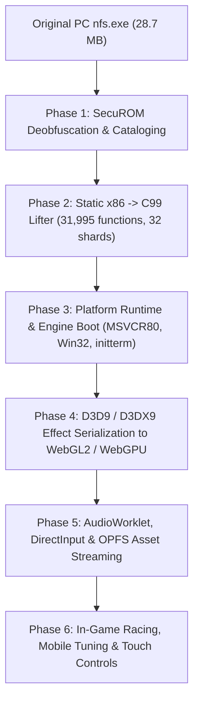

# PortSpeed

> **Experimental native browser port of Need for Speed: ProStreet (2007) using x86 static recompilation and WebAssembly.**

---

## Legal & Research Disclaimer

**PortSpeed is an independent reverse-engineering and preservation research project.**
- This project is **not** affiliated with, sponsored by, or endorsed by Electronic Arts, EA Black Box, or their licensors.
- "Need for Speed" and "Need for Speed: ProStreet" are trademarks of Electronic Arts Inc.
- **No copyrighted game assets, proprietary binaries, or original game code are distributed in this repository.** Users must supply their own legally purchased copy of *Need for Speed: ProStreet* (PC v1.1).

---

## Architectural Strategy: AOT Static Recompilation

PortSpeed brings the original 2007 PC Windows x86 game to modern web browsers via **Ahead-Of-Time (AOT) static binary recompilation** rather than full instruction emulation or manual gameplay rewriting:



1. **Ahead-Of-Time Translation:** The original MSVC 8.0 x86 machine code in `nfs.exe` (31,995 functions across 220,816 basic blocks) is translated into 32 modular C99 shards (`shard_00.c` .. `shard_31.c`) with native WebAssembly SIMD128 intrinsics, 80-bit x87 FPU stack emulation, and bit-parallel arithmetic flag computation.
2. **1:1 Guest Linear Memory:** Guest virtual addresses (`0x00000000..0x28000000`, 640 MB) map directly 1:1 into WebAssembly linear memory (`IMAGE_BASE=0`), completely eliminating pointer translation overhead for game data and memory access.
3. **Master Dispatch Table (`g_dtab`):** Direct $O(1)$ function pointer array of 5.6M entries covering `0x00401000..0x00967000`, dispatching lifted functions and imported shims at native execution speed.
4. **Clean CRT & Win32 Shims:** Dynamic `MSVCR80.dll` IAT imports (156 functions) and Win32 imports (198 functions) are shimmed in clean C99 to provide seamless operating system services.
5. **Strict Source-Protection Discipline:** The original target installation is strictly read-only. No original executables, assets, or decompiled code are committed to git.

---

## Master Engineering Roadmap & Milestone Status

> [!NOTE]
> For a detailed technical overview of recent achievements, architectural decisions, and handoff instructions, see [**`Oto's latest.md`**](file:///c:/Users/tabat/OneDrive/Desktop/NFS-PortStreet-Project/Oto's%20latest.md).

### Phase 1: SecuROM Deobfuscation & Master Function Catalog [COMPLETED]
- [x] **Step 1.1: Automatic Nopping of Countdown Stubs**: Neutralized all 220 genuine SecuROM countdown stubs in memory (2,640 bytes NOPped).
- [x] **Step 1.2: Symbolic Trampoline & Prologue Resolution**: Emulated 100.0% of all 2,153 indirect jump sites targeting `.securom` via Unicorn Engine 2.1.4 and Capstone, recovering native MSVC stack frame prologues.
- [x] **Step 1.3: Master Control-Flow Recovery**: Discovered and validated 31,995 functions across 220,816 basic blocks with a 99.98% CFG recovery rate (`research/local/phase1/catalog.json`).

### Phase 2: Full-Scale Static x86-to-C99 Lifter [COMPLETED]
- [x] **Step 2.1: Full SSE/SSE2 SIMD128 Instruction Support**: Created `runtime/cpu.h` with 128-bit `xmm_reg_t` and native `<wasm_simd128.h>` intrinsics (`v128_t`).
- [x] **Step 2.2: Comprehensive x87 FPU Stack Emulation**: Full 80-bit extended precision, 8-level circular stack (`st[8]`), and status/control words (FCW/FSW).
- [x] **Step 2.3: Arithmetic Flag Calculation & Fast Path Optimization**: Bit-parallel flag computation (`FLAGS_ADC_M`, `FLAGS_SBB_M`, `FLAGS_LOG_M`) for zero-overhead conditional branching.
- [x] **Step 2.4: 32-Shard Output Pipeline & Master Dispatch Table**: Generated 32 balanced C99 shards (`shard_00.c` .. `shard_31.c`) and master dispatch table `g_dtab`.

### Phase 3: Platform Runtime & Engine Boot Chain [INFRASTRUCTURE VERIFIED]
- [x] **Step 3.1: 1:1 Linear Guest Memory Layout**: Implemented 640 MB guest address space in `runtime/memory.h` and `runtime/memory.c` with null-guard, authentic sections, and BSS.
- [x] **Step 3.2: MSVCR80.dll IAT Shim Layer**: Full C99 implementations of all 156 imports from `MSVCR80.dll` (`runtime/crt.h`, `runtime/crt.c`), bound into `g_dtab`.
- [x] **Step 3.3: Win32 Core Emulation**: Full C99 implementations of 198 imports from `KERNEL32`, `USER32`, `ADVAPI32`, `WINMM`, etc. (`runtime/win32.h`, `runtime/win32.c`).
- [x] **Step 3.4: Static C++ Initializer Chain `_initterm`**: Implemented `runtime/initterm.h` and `runtime/initterm.c`, executing all 960 constructors and hooking the `sub_0082851b` atexit helper.
- [x] **Step 3.5: ProStreet `main()` & Engine Boot Orchestration**: Implemented `runtime/boot.h`, `runtime/boot.c`, and `tools/guest_boot.py`, orchestrating TEB/TLS setup, IAT binding, initializer chain, stack frames, argument parsing (`nfs.exe -safemode`), and clean dry-run lifecycle.
- [x] **Runtime Hygiene & Zero Diagnostics**: All files in `runtime/` maintain **0 errors** across Clangd and MSVC IntelliSense.
- *(Note: Full end-to-end game startup into a continuous simulation loop is unverified pending graphics device resource creation.)*

### Phase 4: Graphics Command Stream & WebGL2 / WebGPU Renderer [IN PROGRESS]
- [x] **Step 4.1: Direct3D 9 COM Compatibility Layer & Command Ring Buffer**:
  - Implemented `Direct3DCreate9` and `IDirect3DDevice9` vtables in C99 (`runtime/d3d9.h`, `runtime/d3d9.c`).
  - Implemented lockless shared-memory command ring buffer (`runtime/d3d9_cmd.h`) with 32-byte header, 8-byte aligned packets, and wraparound handling.
  - Lifted and executed genuine game graphics initialization routines (`sub_0070e150` device creation, `sub_00705d30` scene render loop) producing valid command streams.
- [x] **Step 4.2: D3DX9 Effect (`ID3DXEffect`) Parser & Authentic Shader Validation**:
  - Built read-only parser (`tools/d3dx9_effect.py`) for compiled D3DX9 `.fx` effect files (`FXv1` format).
  - Parsed all 34 embedded effect resources in `.rsrc`, cataloging parameters, techniques, passes, samplers, and 597 shader bytecodes.
  - Transpiled D3D9 shader bytecode to GLSL ES 3.00 via MojoShader.
  - Completed authenticity audit verifying `IDI_STANDARD_FX` `standard::p0` genuine shader pair (`vs_1_1` at `0x0bc0` + `ps_2_0` at `0x0a68`).
  - Compiled and rendered the authentic shader pair in headless Chrome WebGL2 using diagnostic textures and geometry.
- [ ] **Step 4.3: TypeScript Browser GPU Host & Render Pipeline [ACTIVE]**:
  - [x] **Command Consumer Core (`web/src/d3d9_consumer.ts`)**: Reads ring buffer packets; handles `BEGIN_SCENE`, `END_SCENE`, and `PRESENT`.
  - [x] **Viewport & Scissor**: `SET_VIEWPORT` coordinate translation from D3D9 (top-left) to WebGL2 (bottom-left) and $[0, 1]$ depth ranges.
  - [x] **Render States**: Supports 8 critical states (`ZENABLE`, `ZWRITEENABLE`, `ZFUNC`, `CULLMODE`, `ALPHABLENDENABLE`, `SRCBLEND`, `DESTBLEND`, `COLORWRITEENABLE`).
  - [x] **Direct3D 9 Clear Semantics Correction**: Corrected `CLEAR` handler to unconditionally unmask color, depth, and stencil writes during clears per D3D9 specification, restoring active state masks for subsequent draw calls.
  - [ ] **Next Substep**: **Vertex Buffer Resource Lifecycle & Stream Binding** (`D3DCMD_CREATE_VERTEX_BUFFER`, `D3DCMD_UPDATE_VERTEX_BUFFER`, `D3DCMD_SET_STREAM_SOURCE`, `D3DCMD_DESTROY_VERTEX_BUFFER`).
  - [ ] **Pending**: Index buffers, vertex declarations, textures/samplers, and draw call packet processing (`D3DCMD_DRAW_PRIMITIVE`).

### Phase 5: Audio, Input, Asset Streaming & Web Application Shell [PLANNED]
- [ ] **Step 5.1: DirectInput8 Keyboard, Gamepad & Touch Controls**: Browser SharedArrayBuffer input mapping + NFSU mobile touch overlay.
- [ ] **Step 5.2: DirectSound AudioWorklet Pipeline**: Zero-latency PCM audio streaming to AudioWorklet thread.
- [ ] **Step 5.3: OPFS Chunk-Based Asset Streaming**: Origin Private File System streaming worker for 5.6 GB game assets.
- [ ] **Step 5.4: Web Application Shell**: Responsive full-screen PWA interface (Play, Settings, Controls, Game Data).

### Phase 6: Racing Gameplay, Mobile Optimizations & Polish [PLANNED]
- [ ] **Step 6.1: Full Race Simulation & Physics Validation**: Havok physics integration, AI behavior, collision detection.
- [ ] **Step 6.2: Mobile Performance Presets**: Dynamic resolution scaling, ASTC 4x4 texture compression, and mobile graphics tiers.

---

## Current Status & Limitations

> [!WARNING]
> **Authenticity & Playability Status**: PortSpeed is an ongoing static recompilation and systems reverse-engineering project. **The game is not yet playable in the browser, and complete 3D game scenes are not yet rendering.**
>
> All verified rendering milestones to date use isolated lifted initialization routines, diagnostic geometry (test triangles/quads), and test textures to mathematically and visually validate shader and command consumer correctness. Full game startup and in-game scene rendering remain dependent on completing Phase 4.3 (vertex/index buffers, textures, draw calls) and Phase 5 (asset streaming and input).

### What is verified:
- **225 tests passing (100% green)** in Python unittest suite, covering PE parsing, DRM stub neutralization, trampoline resolution, CRT/Win32 shims, boot chain, D3D9 COM vtables, D3DX9 effect parsing, MojoShader GLSL transpilation, and WebGL2 command consumption.
- **11 unit tests passing (100% green)** in TypeScript D3D9 consumer suite.
- D3D9 `Clear` unconditionally clears all color and depth channels regardless of write masks, and restores active render masks for geometry rendering.
- Lifted graphics initialization functions (`sub_0070e150` and `sub_00705d30`) write genuine ring buffer command packets processed by WebGL2.

### What is pending:
- Vertex buffer and index buffer creation, uploading, and stream binding.
- Texture resource lifecycle (loading BC1/BC2/BC3 textures into WebGL2) and sampler bindings.
- Draw call execution (`DrawPrimitive`, `DrawIndexedPrimitive`).
- End-to-end continuous game execution loop and physics tick.
- DirectInput8 controls, DirectSound audio, and OPFS asset streaming.

---

## Repository Structure

```
├── .clangd                        # Clangd language server configuration (zero errors)
├── .gitignore                     # Strict exclusions for game binaries and local outputs
├── AGENTS.md                      # AI agent guidelines, constraints, and non-negotiable rules
├── Oto's latest.md                # Comprehensive technical handoff and architecture status
├── README.md                      # Project architecture, master plan, and status
├── include/                       # Clean C99 declaration headers for language server
│   ├── ctype.h
│   ├── errno.h
│   ├── math.h
│   ├── stdio.h
│   ├── stdlib.h
│   ├── string.h
│   └── time.h
├── runtime/                       # Platform runtime and engine boot chain (14 files)
│   ├── boot.c / boot.h            # Engine boot orchestration & main() invocation
│   ├── cpu.h                      # x86-32 execution state, SIMD128, x87 FPU, g_dtab
│   ├── crt.c / crt.h              # MSVCR80.dll IAT shims (156 functions)
│   ├── d3d9.c / d3d9.h            # Direct3D 9 COM vtables & device shims
│   ├── d3d9_cmd.h                 # D3D9 command ring buffer protocol definitions
│   ├── initterm.c / initterm.h    # Static C++ initializers (960 constructors)
│   ├── memory.c / memory.h        # 1:1 Guest linear memory layout (640 MB)
│   └── win32.c / win32.h          # Win32 core emulation shims (198 functions)
├── gen/                           # Generated C99 shards and dispatch tables
├── research/                      # Reverse engineering documentation and reports
├── tests/                         # Automated test suite (225 tests, 100% green)
│   ├── test_archives.py
│   ├── test_boot.py               # Engine boot chain & main() lifecycle tests
│   ├── test_catalog.py            # Master function catalog tests
│   ├── test_crt_shims.py          # MSVCR80.dll shims tests
│   ├── test_d3d9.py               # D3D9 COM interface and vtable tests
│   ├── test_d3d9_cmd.py           # D3D9 command ring buffer tests
│   ├── test_d3d9_consumer.py      # WebGL2 consumer & render state tests (headless Chrome)
│   ├── test_d3d9_integration.py   # Lifted sub_0070e150 / sub_00705d30 WASM tests
│   ├── test_d3d9_shader_transpile.py # MojoShader translation & WebGL2 shader tests
│   ├── test_d3d9_wasm.mjs         # Node.js WASM integration runner
│   ├── test_d3dx9_effect.py       # D3DX9 effect parser tests (34 effects)
│   ├── test_drm_cleaner.py        # SecuROM stub neutralization tests
│   ├── test_guest_memory.py       # Guest memory layout tests
│   ├── test_initterm.py           # Static C++ initializers tests
│   ├── test_lifter_opt.py         # Bit-parallel flag optimization tests
│   ├── test_lifter_sse.py         # SIMD128 vector instruction tests
│   ├── test_lifter_x87.py         # x87 FPU circular stack tests
│   ├── test_sharder.py            # 32-shard generator tests
│   ├── test_tpk.py                # Texture container tests
│   ├── test_trampoline_analyzer.py# SecuROM trampoline resolution tests
│   └── test_win32_shims.py        # Win32 API shims tests
├── tools/                         # Static analysis, lifters, shims, and simulation tools
│   ├── build_catalog.py
│   ├── build_crt_shims.py
│   ├── build_win32_shims.py
│   ├── clean_drm.py
│   ├── d3d9_consumer.bundle.js    # Pre-bundled IIFE build of TypeScript consumer
│   ├── d3dx9_effect.py            # Read-only binary parser for compiled D3DX9 effects
│   ├── generate_shards.py
│   ├── guest_boot.py              # Python engine boot simulator
│   ├── guest_crt.py
│   ├── guest_d3d9.py              # D3D9 simulator and packet verifier
│   ├── guest_initterm.py
│   ├── guest_memory.py
│   ├── guest_win32.py
│   ├── inspect_fx.py
│   ├── inventory_effects.py       # Effect extraction and cataloging utility
│   ├── lift_catalog.py
│   ├── lift_d3d9.py               # Extractor for genuine graphics initialization functions
│   ├── test_webgl2_shader.py      # Headless WebGL2 shader runner
│   └── trampoline_analyzer.py
└── web/                           # Browser WebGL2 frontend & TypeScript consumer
    ├── src/
    │   └── d3d9_consumer.ts       # D3D9 command ring buffer WebGL2 consumer
    └── tests/
        └── d3d9_consumer.test.ts  # Node.js unit tests for command consumer
```

---

## Running Tests

All tests run cleanly with zero external runtime dependencies:

```powershell
# 1. Run the complete Python test suite (225 tests, 100% passing)
python -m unittest discover -s tests -v

# 2. Run the TypeScript D3D9 consumer test suite (11 unit tests)
npx tsx web/tests/d3d9_consumer.test.ts

# 3. Run the engine boot simulation
python tools/guest_boot.py
```
