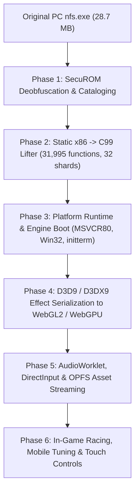

# PortSpeed

> **Experimental native browser port of Need for Speed: ProStreet (2007) using x86 static recompilation and WebAssembly.**

---

## Legal & Research Disclaimer

**PortSpeed is an independent reverse-engineering and preservation research project.**
- This project is **not** affiliated with, sponsored by, or endorsed by Electronic Arts, EA Black Box, or their licensors.
- "Need for Speed" and "Need for Speed: ProStreet" are trademarks of Electronic Arts Inc.
- **No copyrighted game assets, proprietary binaries, or original game code are distributed in this repository.** Users must supply their own legally purchased copy of *Need for Speed: ProStreet* (PC v1.1).

---

## Architectural Strategy: AOT Static Recompilation

PortSpeed brings the original 2007 PC Windows x86 game to modern web browsers via **Ahead-Of-Time (AOT) static binary recompilation** rather than full instruction emulation or building a reimplemented racing clone:



1. **Ahead-Of-Time Translation:** The original MSVC 8.0 x86 machine code in `nfs.exe` (31,995 functions across 220,816 basic blocks) is translated into 32 modular C99 shards (`shard_0000.c` .. `shard_0031.c`) with native WebAssembly SIMD128 intrinsics, 80-bit x87 FPU stack emulation, and bit-parallel arithmetic flag computation.
2. **1:1 Guest Linear Memory:** Guest virtual addresses (`0x00000000..0x28000000`, 640 MB) map directly 1:1 into WebAssembly linear memory (`IMAGE_BASE=0`), completely eliminating pointer translation overhead for game data and memory access.
3. **Master Dispatch Table (`g_dtab`):** Direct $O(1)$ function pointer array of 5.6M entries covering `0x00401000..0x00967000`, dispatching lifted functions and imported shims at native execution speed.
4. **Clean CRT & Win32 Shims:** Dynamic `MSVCR80.dll` IAT imports (156 functions) and Win32 imports (198 functions) are shimmed in clean C99 to provide operating system services.
5. **No Synthetic Remake / Clean Scope:** PortSpeed strictly aims to recompile and execute authentic *Need for Speed: ProStreet* code. It contains no synthetic racing physics, hardcoded tracks, placeholder cars, or fake game loops. The interactive browser entry point (`web/`) is strictly a research "Asset Lab" for inspecting original game textures and vehicle geometries.

---

## Current Engineering Status & Verified Reality

> [!WARNING]
> **Authenticity & Playability Status**:
> - **The original game is NOT yet playable in the browser.**
> - **Original game menus, 3D world rendering, racing physics, and gameplay loops are NOT active.**
> - **A complete real browser game boot has NOT been achieved.**
> - While an emulated Unicorn test completed all 960 C++ static initializers in isolation, **this must not be confused with WebAssembly execution.**
> - In genuine WebAssembly, the combined recompiled binary [`build/game.wasm`](file:///c:/Users/tabat/OneDrive/Desktop/NFS-PortStreet-Project/build/game.wasm) (44.25 MB) now builds cleanly and begins authentic execution under Node.js WASI, but execution currently halts inside constructor callback invocation due to a guest x86 `CALL`/`RET` return-address stack semantics mismatch.

### What is verified:
- **Full Combined WASM Build**: The entire lifted engine (32 shards + platform runtime + dispatch table) builds into a monolithic 44.25 MB WebAssembly module (`build/game.wasm`) via Zig 0.13.0 and `wasm-ld`.
- **Authentic Startup Execution**: Under Node.js WASI, genuine game code loads authentic PE sections, sets up the Win32 TEB (`0x00100000`), binds IAT shims, and invokes C++ static initializers via `initterm_run_cpp_constructors`.
- **SEH Prologue / Callee-Cleanup Stack Balance**: MSVC `__EH_prolog` (`sub_00828ebc`), `__EH_epilog` (`sub_00828f01`), and callee cleanup `ret <imm16>` were corrected in `tools/lift_catalog.py`, successfully advancing constructor execution past `sub_00828652` into constructor callback `sub_004fed90`.
- **D3D9 Compatibility Layer & Shaders**: Lockless command ring buffer (64-byte header), 34 D3DX9 effect files parsed, 597 shaders cataloged, and authentic shader pairs validated in WebGL2.
- **234 unit tests passing (100% green, 12 skipped, 0 failures)** in the Python unittest suite.

---

## Master Engineering Roadmap & Milestone Status

> [!NOTE]
> For a detailed technical overview of recent achievements, architectural decisions, and handoff instructions, see [**`Oto's latest.md`**](file:///c:/Users/tabat/OneDrive/Desktop/NFS-PortStreet-Project/Oto's%20latest.md).

### Phase 1: SecuROM Deobfuscation & Master Function Catalog [COMPLETED]
- [x] **Step 1.1: Automatic Nopping of Countdown Stubs [VERIFIED]**: Neutralized all 220 genuine SecuROM countdown stubs in memory (2,640 bytes NOPped).
- [x] **Step 1.2: Symbolic Trampoline & Prologue Resolution [VERIFIED]**: Emulated 100.0% of all 2,153 indirect jump sites targeting `.securom` via Unicorn Engine 2.1.4 and Capstone, recovering native MSVC stack frame prologues.
- [x] **Step 1.3: Master Control-Flow Recovery [VERIFIED]**: Discovered and validated 31,995 functions across 220,816 basic blocks with a 99.98% CFG recovery rate.

### Phase 2: Full-Scale Static x86-to-C99 Lifter [COMPLETED]
- [x] **Step 2.1: Full SSE/SSE2 SIMD128 Instruction Support [VERIFIED]**: Created `runtime/cpu.h` with 128-bit `xmm_reg_t` and native `<wasm_simd128.h>` intrinsics (`v128_t`).
- [x] **Step 2.2: Comprehensive x87 FPU Stack Emulation [VERIFIED]**: Full 80-bit extended precision, 8-level circular stack (`st[8]`), and status/control words (FCW/FSW).
- [x] **Step 2.3: Arithmetic Flag Calculation & Fast Path Optimization [VERIFIED]**: Bit-parallel flag computation (`FLAGS_ADC_M`, `FLAGS_SBB_M`, `FLAGS_LOG_M`) for zero-overhead conditional branching.
- [x] **Step 2.4: 32-Shard Output Pipeline & Master Dispatch Table [VERIFIED]**: Generated 32 balanced C99 shards (`shard_0000.c` .. `shard_0031.c`) and master dispatch table `g_dtab`.

### Phase 3: Platform Runtime & Engine Boot Chain [IN PROGRESS — WASM INITIALIZATION IN FLIGHT]
- [x] **Step 3.1: 1:1 Linear Guest Memory Layout [VERIFIED]**: Implemented 640 MB guest address space in `runtime/memory.h` and `runtime/memory.c` with null-guard, authentic sections, and BSS.
- [x] **Step 3.2: MSVCR80.dll IAT Shim Layer [VERIFIED]**: Full C99 implementations of all 156 imports from `MSVCR80.dll` (`runtime/crt.h`, `runtime/crt.c`), bound into `g_dtab`.
- [x] **Step 3.3: Win32 Core Emulation [VERIFIED]**: Full C99 implementations of 198 imports from `KERNEL32`, `USER32`, `ADVAPI32`, `WINMM`, etc. (`runtime/win32.h`, `runtime/win32.c`).
- [x] **Step 3.4: Static C++ Initializer Chain `_initterm` [WASM EXECUTION IN PROGRESS]**:
  - Combined monolithic C99-to-WASM binary linked (`build/game.wasm`, 44.25 MB).
  - Authentic `sub_0082851b` atexit helper hooked.
  - Implemented missing D3DX9 shims (`D3DXMatrixTranspose`, `D3DXVec3Transform`).
  - Corrected MSVC `__EH_prolog` (`sub_00828ebc`), `__EH_epilog` (`sub_00828f01`), and `ret <imm16>` callee cleanup.
  - Advanced constructor execution through `sub_00959c30` -> `sub_00828652` -> `sub_004fed90`.
  - **Current Blocker**: x86 CALL instructions push a 4-byte return address, which functions reading arguments at `[esp + 4]` (such as `sub_0052b8d0`) depend on. A systematic compatibility mechanism is needed to supply this layout without breaking existing platform shims reading `[esp]`.
- [ ] **Step 3.5: ProStreet `main()` & Engine Boot Orchestration [PENDING INITIALIZERS]**: Stack frame setup, argument parsing, and entering `main()` at `0x004afee0`.
- [x] **Runtime Hygiene & Zero Diagnostics**: All files in `runtime/` maintain **0 errors** across Clangd and MSVC IntelliSense.

### Phase 4: Graphics Command Stream & WebGL2 / WebGPU Renderer [IN PROGRESS / INTEGRATION PENDING]
- [x] **Step 4.1: Direct3D 9 COM Compatibility Layer & Command Ring Buffer [TESTED IN ISOLATION]**:
  - Implemented `Direct3DCreate9` and `IDirect3DDevice9` vtables in C99 (`runtime/d3d9.h`, `runtime/d3d9.c`).
  - Lockless shared-memory ring buffer (`runtime/d3d9_cmd.h`) with a **64-byte** cache-line aligned control header, 8-byte aligned packets, and wraparound handling.
  - Lifted genuine graphics initialization routines (`sub_0070e150` and `sub_00705d30`) write valid command streams verified in isolated test harnesses.
- [x] **Step 4.2: D3DX9 Effect (`ID3DXEffect`) Parser & Authentic Shader Validation [TESTED IN ISOLATION]**:
  - Parsed all 34 embedded effect resources in `.rsrc`, cataloging parameters, techniques, passes, samplers, and 597 shader bytecodes.
  - Transpiled D3D9 shader bytecode to GLSL ES 3.00 via MojoShader and validated authentic shader pair rendering in headless Chrome WebGL2.
- [ ] **Step 4.3: TypeScript Browser GPU Host & Render Pipeline [ACTIVE / IN PROGRESS]**:
  - [x] Command Consumer Core (`web/src/d3d9_consumer.ts`): `BEGIN_SCENE`, `END_SCENE`, `PRESENT`.
  - [x] Viewport & Scissor: top-left to bottom-left coordinate conversion.
  - [x] Render States: 8 critical states (`ZENABLE`, `ZWRITEENABLE`, `ALPHABLENDENABLE`, etc.).
  - [x] D3D9 Clear Semantics: unconditional write mask override during clear operations.
  - [ ] Pending: Vertex buffer allocation/binding, textures/samplers, and draw calls (`D3DCMD_DRAW_PRIMITIVE`).

### Phase 5: Audio, Input, Asset Streaming & Web Application Shell [PLANNED]
- [ ] **Step 5.1: DirectInput8 Keyboard, Gamepad & Touch Controls**: Browser SharedArrayBuffer input mapping.
- [ ] **Step 5.2: DirectSound AudioWorklet Pipeline**: Low-latency PCM audio streaming to AudioWorklet thread.
- [ ] **Step 5.3: OPFS Chunk-Based Asset Streaming**: Origin Private File System streaming worker for 5.6 GB game assets.
- [ ] **Step 5.4: Web Application Shell**: Full-screen PWA interface.

### Phase 6: Racing Gameplay, Mobile Optimizations & Polish [PLANNED]
- [ ] **Step 6.1: Full Race Simulation & Physics Validation**: Havok physics integration, AI behavior, collision detection.
- [ ] **Step 6.2: Mobile Performance Presets**: Resolution scaling, ASTC 4x4 texture compression, and mobile graphics tiers.

---

## Running Tests

```powershell
# 1. Run the complete Python test suite (234 tests, 100% passing)
python -m unittest discover -s tests -v

# 2. Run the SEH prolog/epilog & callee cleanup WASM verification
node tests/test_seh_prolog_wasm.mjs

# 3. Run the genuine ProStreet monolithic WASM startup diagnostic
node tests/test_game_wasm.mjs

# 4. Run the TypeScript D3D9 consumer test suite (11 unit tests)
npx tsx web/tests/d3d9_consumer.test.ts

# 5. Rebuild the monolithic WebAssembly module
python tools/build_wasm.py
```
