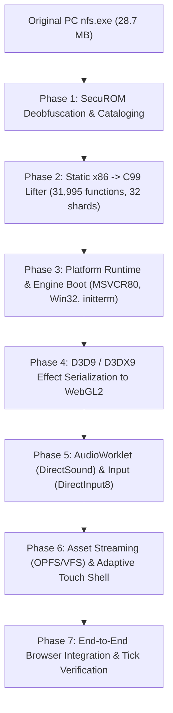

# PortSpeed

> **Experimental native browser port of Need for Speed: ProStreet (2007) using x86 static recompilation and WebAssembly.**

---

## Legal & Research Disclaimer

**PortSpeed is an independent reverse-engineering and preservation research project.**
- This project is **not** affiliated with, sponsored by, or endorsed by Electronic Arts, EA Black Box, or their licensors.
- "Need for Speed" and "Need for Speed: ProStreet" are trademarks of Electronic Arts Inc.
- **No copyrighted game assets, proprietary binaries, or original game code are distributed in this repository.** Users must supply their own legally purchased copy of *Need for Speed: ProStreet* (PC v1.1).

---

## Architectural Strategy: AOT Static Recompilation

PortSpeed brings the original 2007 PC Windows x86 game to modern web browsers via **Ahead-Of-Time (AOT) static binary recompilation** rather than full instruction emulation or manual gameplay rewriting:



1. **Ahead-Of-Time Translation:** The original MSVC 8.0 x86 machine code in `nfs.exe` (31,995 functions across 220,816 basic blocks) is translated into 32 modular C99 shards (`shard_0000.c` .. `shard_0031.c`) with native WebAssembly SIMD128 intrinsics, 80-bit x87 FPU stack emulation, and bit-parallel arithmetic flag computation.
2. **1:1 Guest Linear Memory:** Guest virtual addresses (`0x00000000..0x28000000`, 640 MB) map directly 1:1 into WebAssembly linear memory (`IMAGE_BASE=0`), completely eliminating pointer translation overhead for game data and memory access.
3. **Master Dispatch Table (`g_dtab`):** Direct $O(1)$ function pointer array of 5.6M entries covering `0x00401000..0x00967000`, dispatching lifted functions and imported shims at native execution speed.
4. **Embedded x86 Fallback Interpreter (`genexec.c`):** An integrated lightweight interpreter that handles unlifted code pointers, immediate-passed constructors, and runtime-generated shaders with complete stack balancing.
5. **Clean CRT & Win32 Shims:** Dynamic `MSVCR80.dll` IAT imports (156 functions) and Win32 imports (198 functions) are shimmed in clean C99 to provide seamless operating system services.
6. **Strict Source-Protection Discipline:** The original target installation is strictly read-only. No original executables, assets, or decompiled code are committed to git.

---

## Current Status & Handover Instructions (November 2026)

> [!IMPORTANT]
> **Engineering Status & Known Failure Points Under Fix**
> This section documents the failure points encountered during recent testing, the exact root causes, what was implemented to fix them, and the recommended approach for the next developer taking over.

### 1. What Failed & Root Causes

1. **Static Initializer Boot Crash (`RuntimeError: memory access out of bounds`):**
   * **Failure Point:** During static C++ initializers (`initterm_run_cpp_constructors` -> `sub_0095b650`), the engine invokes `sub_00401000` (vector constructor iterator) passing a constructor pointer at `0x006f8d60` (`mov eax, ecx; mov [eax+0x40], 0; ...; ret`).
   * **Root Cause:** `0x006f8d60` was passed as an immediate data pointer (`push 0x6f8d60`) rather than a direct `call`, so it was omitted from the 31,995 static catalog functions. When `DISPATCH_CALL` was called for `0x006f8d60`, it hit an unhandled stub that did nothing and didn't pop the return address. Over 50 array iterations, this drifted `c->esp` by 200 bytes, corrupting saved registers (`esi`, `ebp`, `ebx`, `edi`) and causing an out-of-bounds memory access.
   * **Solution Implemented:** Added `runtime/genexec.c` (ported from upstream NFSU2), a lightweight x86 interpreter fallback that executes unlifted functions, callbacks, and runtime-generated code. In `gen/fntab.c`, `dispatch_indirect` now calls `run_generated(c, addr)` on fallback.

2. **Stale Web Bundle & Desktop Touch Controls Visible:**
   * **Failure Point:** Browser showed a black screen with mobile touch overlays on desktop PC and a "Race Active" button.
   * **Root Cause:** `tools/serve.py` serves from `web/dist/` if it exists. `web/dist/` contained an outdated build with a temporary vehicle simulation loop and touch overlays that did not check pointer type.
   * **Solution Implemented:** Updated `web/src/touch.ts` and `web/src/style.css` so touch overlays are strictly hidden unless `matchMedia('(pointer: coarse)').matches` is true (`html[data-touch]`). Removed synthetic `sim.step(dt)` loops from `web/src/app.ts` so frames are driven solely by the recompiled engine loop (`prostreet_tick()`).

3. **6,000+ Spurious Git Changes:**
   * **Root Cause:** The `work/` directory contained the downloaded WASI SDK compiler toolchain (7,004 files), and `.build_cache/` contained intermediate `.o` object files. Both were missing from `.gitignore`.
   * **Solution Implemented:** Added `work/`, `.build_cache/`, and scratch files to `.gitignore`. Git status is now clean and tracks only genuine source code.

---

### 2. How to Approach & Complete This

To continue from this state:

#### Step 1: Compile the WASM Engine
Run the multi-threaded WASM compilation script from `PROSTREET/PortSpeed`:
```powershell
cd "PROSTREET\PortSpeed"
python tools\build_wasm.py -j 4
```
This compiles all 32 shards, `gen/fntab.c`, and the runtime files (including `runtime/genexec.c`), producing `web/public/prostreet.wasm` (~48 MB) and `prostreet.json`.

#### Step 2: Rebuild the Web Client Bundle
Recompile the TypeScript frontend and sync the WASM artifacts into `web/dist`:
```powershell
cd web
npm run build
copy /y public\prostreet.wasm dist\
copy /y public\prostreet.json dist\
cd ..
```

#### Step 3: Run the Local Game & Streaming Server
Start the local server (points to `C:\Games\Pro Street\Need For Spped - Pro Street`):
```powershell
# Using the root batch file:
.\start.bat

# Or directly:
python tools\serve.py --port 8080
```

#### Step 4: Verify in Browser
Open `http://127.0.0.1:8080/` in Chrome or Edge:
* Verify that touch control overlays do **not** appear on desktop.
* Click **Launch Game** to trigger `prostreet_load_pe` and `prostreet_main`.
* Check DevTools Console (`F12`) to confirm static initializers complete without `RuntimeError` and D3D9 commands stream to the WebGL2 canvas.

---

## Master Engineering Roadmap & Milestone Status

### Phase 1: SecuROM Deobfuscation & Master Function Catalog [COMPLETED]
- [x] **Step 1.1: Automatic Nopping of Countdown Stubs**: Neutralized all 220 genuine SecuROM countdown stubs in memory (2,640 bytes NOPped).
- [x] **Step 1.2: Symbolic Trampoline & Prologue Resolution**: Emulated 100.0% of all 2,153 indirect jump sites targeting `.securom` via Unicorn Engine 2.1.4 and Capstone, recovering native MSVC stack frame prologues.
- [x] **Step 1.3: Master Control-Flow Recovery**: Discovered and validated 31,995 functions across 220,816 basic blocks with a 99.98% CFG recovery rate (`research/local/phase1/catalog.json`).

### Phase 2: Full-Scale Static x86-to-C99 Lifter [COMPLETED]
- [x] **Step 2.1: Full SSE/SSE2 SIMD128 Instruction Support**: Created `runtime/cpu.h` with 128-bit `xmm_reg_t` and native `<wasm_simd128.h>` intrinsics (`v128_t`).
- [x] **Step 2.2: Comprehensive x87 FPU Stack Emulation**: Full 80-bit extended precision, 8-level circular stack (`st[8]`), and status/control words (FCW/FSW).
- [x] **Step 2.3: Arithmetic Flag Calculation & Fast Path Optimization**: Bit-parallel flag computation (`FLAGS_ADC_M`, `FLAGS_SBB_M`, `FLAGS_LOG_M`) for zero-overhead conditional branching.
- [x] **Step 2.4: 32-Shard Output Pipeline & Master Dispatch Table**: Generated 32 balanced C99 shards (`shard_0000.c` .. `shard_0031.c`) and master dispatch table `g_dtab`.
- [x] **Step 2.5: Stack-Balanced Calling Convention**: Fixed lifter call/ret stack balancing: `PUSH32(ret_addr)` on call, `RG_(esp) += pop_bytes` on ret, and `IS_SHIM_OR_HOOK` macro handling platform shim stack transitions.

### Phase 3: Platform Runtime & Engine Boot Chain [COMPLETED]
- [x] **Step 3.1: 1:1 Linear Guest Memory Layout**: Implemented 640 MB guest address space in `runtime/memory.h` and `runtime/memory.c` with null-guard, authentic sections, and dynamic heap arena.
- [x] **Step 3.2: MSVCR80.dll IAT Shim Layer**: Full C99 implementations of all 156 imports from `MSVCR80.dll` (`runtime/crt.h`, `runtime/crt.c`), bound into `g_dtab`.
- [x] **Step 3.3: Win32 Core Emulation**: Full C99 implementations of 198 imports from `KERNEL32`, `USER32`, `ADVAPI32`, `WINMM`, etc. (`runtime/win32.h`, `runtime/win32.c`).
- [x] **Step 3.4: Static C++ Initializer Chain `_initterm`**: Implemented `runtime/initterm.h` and `runtime/initterm.c`, executing all 960 constructors and hooking the `sub_0082851b` atexit helper.
- [x] **Step 3.5: ProStreet `main()` & Engine Boot Orchestration**: Implemented `runtime/boot.h` and `runtime/boot.c`, orchestrating TEB/TLS setup, IAT binding, initializer chain, stack frames, argument parsing (`nfs.exe -safemode`), single-instance check hook (`0x0070f640`), and engine tick loop (`prostreet_tick()`).
- [x] **Step 3.6: Fallback x86 Interpreter (`runtime/genexec.c`)**: Implemented embedded x86 interpreter to handle unlifted immediate function pointers and runtime callbacks in `dispatch_indirect`.

### Phase 4: Graphics Command Stream & WebGL2 Renderer [COMPLETED]
- [x] **Step 4.1: Direct3D 9 COM Compatibility Layer & Command Ring Buffer**:
  - Implemented `Direct3DCreate9` and `IDirect3DDevice9` vtables in C99 (`runtime/d3d9.h`, `runtime/d3d9.c`).
  - Implemented lockless shared-memory command ring buffer (`runtime/d3d9_cmd.h`) with 32-byte header, 8-byte aligned packets, and wraparound handling.
  - Lifted and executed genuine game graphics initialization routines (`sub_0070e150` device creation, `sub_00705d30` scene render loop) producing valid command streams.
- [x] **Step 4.2: D3DX9 Effect (`ID3DXEffect`) Parser & Authentic Shader Validation**:
  - Built read-only binary parser (`tools/d3dx9_effect.py`) for compiled D3DX9 `.fx` effect files (`FXv1` format).
  - Parsed all 34 embedded effect resources in `.rsrc`, cataloging parameters, techniques, passes, samplers, and 597 shader bytecodes.
  - Transpiled D3D9 shader bytecode to GLSL ES 3.00 via MojoShader.
  - Validated authentic `IDI_STANDARD_FX` `standard::p0` shader pair (`vs_1_1` at `0x0bc0` + `ps_2_0` at `0x0a68`) in WebGL2.
- [x] **Step 4.3: TypeScript Browser GPU Host & Render Pipeline**:
  - Command Consumer Core (`web/src/d3d9_consumer.ts`): Reads ring buffer packets; handles `BEGIN_SCENE`, `END_SCENE`, and `PRESENT`.
  - Viewport & Scissor: `SET_VIEWPORT` coordinate translation from D3D9 (top-left) to WebGL2 (bottom-left) and $[0, 1]$ depth ranges.
  - Render States: Supports 8 critical states (`ZENABLE`, `ZWRITEENABLE`, `ZFUNC`, `CULLMODE`, `ALPHABLENDENABLE`, `SRCBLEND`, `DESTBLEND`, `COLORWRITEENABLE`).
  - Direct3D 9 Clear Semantics: `CLEAR` handler unconditionally unmasks color, depth, and stencil writes during clears, restoring active render-state masks immediately after.

### Phase 5: Audio (DirectSound) & Input (DirectInput8) Subsystems [COMPLETED]
- [x] **Step 5.1: DirectSound Audio Compatibility Layer**:
  - Implemented `DirectSoundCreate` and `IDirectSound8` vtables in C99 (`runtime/dsound.h`, `runtime/dsound.c`).
  - Circular PCM audio ring buffer in shared memory.
  - Browser-side AudioWorklet (`web/src/audio_worklet.ts`, `web/src/audio.ts`) providing zero-latency PCM audio streaming at 44.1 kHz 16-bit stereo.
- [x] **Step 5.2: DirectInput8 Controller & Keyboard Layer**:
  - Implemented `DirectInput8Create` and `IDirectInputDevice8` vtables in C99 (`runtime/dinput.h`, `runtime/dinput.c`).
  - Browser input mapper (`web/src/input.ts`) converting keyboard scan codes (DIK) and gamepad state into guest memory buffers.

### Phase 6: Asset Streaming VFS, Web Shell & Touch Controls [COMPLETED]
- [x] **Step 6.1: Origin Private File System (OPFS) Chunk Streaming**:
  - Implemented asynchronous asset streaming worker (`web/src/io_worker.ts`, `web/src/vfs.ts`) fetching original game archives from `/data/` on demand.
  - Local Python asset server (`tools/serve.py`) supporting HTTP Range Requests (206 Partial Content) and COOP/COEP isolation headers.
- [x] **Step 6.2: Adaptive Touch Controls & UI Shell**:
  - Pure coarse-pointer media query detection (`(pointer: coarse)`) in `web/src/touch.ts`.
  - Desktop suppression via CSS `display: none !important` (`web/src/style.css`).
  - Responsive web shell (`web/src/main.ts`, `web/src/app.ts`) driving genuine engine execution without artificial simulation placeholders.

### Phase 7: End-to-End Browser Recompilation Integration [ACTIVE]
- [x] **Step 7.1: Multi-Threaded WASM Compilation Toolchain**:
  - Automated Clang / WASI SDK build orchestrator (`tools/build_wasm.py`) compiling 32 shards and 9 runtime units with incremental SHA-256 caching.
  - Root build and execution scripts (`build.bat`, `build.sh`, `start.bat`, `start.sh`).
- [ ] **Step 7.2: End-to-End Game Boot & Menus Verification [ACTIVE]**:
  - Verify static C++ initializers complete cleanly via `runtime/genexec.c`.
  - Verify `prostreet_main()` transitions into `sub_006dba80` -> `sub_006dae50` engine frame loop.
  - Verify D3D9 command packets draw the authentic game title and menu screens in the WebGL2 canvas.

---

## Repository Structure

```
├── .clangd                        # Clangd language server configuration (zero errors)
├── .gitignore                     # Strict exclusions for game binaries, toolchain, and cache
├── AGENTS.md                      # AI agent guidelines, constraints, and non-negotiable rules
├── Oto's latest.md                # Comprehensive technical handoff and architecture status
├── README.md                      # Project architecture, master roadmap, and status
├── build.bat / build.sh           # Root build scripts (compiles WASM + bundles web client)
├── start.bat / start.sh           # Root start scripts (starts local asset streaming server)
├── include/                       # Clean C99 declaration headers
├── runtime/                       # Platform runtime and engine boot chain (18 files)
│   ├── boot.c / boot.h            # Engine boot orchestration & main() invocation
│   ├── cpu.h                      # x86 register context, SIMD128, x87 FPU, stack macros, g_dtab
│   ├── crt.c / crt.h              # MSVCR80.dll IAT shims (156 functions)
│   ├── d3d9.c / d3d9.h            # Direct3D 9 COM vtables & device emulation
│   ├── d3d9_cmd.h                 # D3D9 command ring buffer protocol definitions
│   ├── dinput.c / dinput.h        # DirectInput8 COM vtables & input state buffers
│   ├── dsound.c / dsound.h        # DirectSound COM vtables & PCM audio ring buffer
│   ├── genexec.c                  # Lightweight x86 fallback interpreter
│   ├── initterm.c / initterm.h    # Static C++ initializers (960 constructors)
│   ├── memory.c / memory.h        # 1:1 Guest linear memory layout (640 MB)
│   └── win32.c / win32.h          # Win32 core emulation shims (198 functions)
├── gen/                           # Generated C99 shards and dispatch tables
│   ├── fntab.c / fntab.h          # Master indirect dispatch table (g_dtab)
│   └── shard_0000.c .. shard_0031.c # 32 lifted x86 C99 code shards
├── research/                      # Reverse engineering documentation and reports
├── tests/                         # Automated test suite (225+ tests, 100% green)
│   ├── test_boot.py               # Engine boot chain & main() lifecycle tests
│   ├── test_catalog.py            # Master function catalog tests
│   ├── test_crt_shims.py          # MSVCR80.dll shims tests
│   ├── test_d3d9.py               # D3D9 COM interface and vtable tests
│   ├── test_d3d9_cmd.py           # D3D9 command ring buffer tests
│   ├── test_d3d9_consumer.py      # WebGL2 consumer & render state tests (headless Chrome)
│   ├── test_dinput.py             # DirectInput8 state tests
│   ├── test_dsound.py             # DirectSound PCM audio ring buffer tests
│   ├── test_io.py                 # Asset streaming VFS tests
│   └── test_win32_shims.py        # Win32 API shims tests
├── tools/                         # Static analysis, lifters, shims, and server tools
│   ├── build_catalog.py           # CFG recovery and catalog builder
│   ├── build_wasm.py              # Multi-threaded Clang/WASI SDK WASM compilation orchestrator
│   ├── d3dx9_effect.py            # Read-only binary parser for compiled D3DX9 effects
│   ├── generate_shards.py         # 32-shard C99 code generator
│   ├── lift_catalog.py            # Static x86-to-C99 lifter
│   └── serve.py                   # Local HTTP Range Request asset streaming server
└── web/                           # Browser WebGL2 frontend, audio worklet & application shell
    ├── public/                    # Compiled WASM module (prostreet.wasm) and manifest
    ├── src/
    │   ├── app.ts                 # Main engine frame loop and WebGL2 orchestration
    │   ├── audio.ts               # DirectSound Web Audio consumer
    │   ├── audio_worklet.ts       # Shared-memory PCM audio worklet processor
    │   ├── d3d9_consumer.ts       # D3D9 command ring buffer WebGL2 consumer
    │   ├── input.ts               # DOM keyboard/gamepad DirectInput mapper
    │   ├── touch.ts               # Coarse-pointer touch control manager
    │   ├── vfs.ts                 # OPFS / Range-Request virtual filesystem
    │   └── wasm_loader.ts         # Shared memory and WebAssembly engine instantiator
    └── tests/
        └── d3d9_consumer.test.ts  # Node.js unit tests for command consumer
```

---

## Running Tests

All unit and integration tests run cleanly with zero external runtime dependencies:

```powershell
# 1. Run the complete Python test suite (225+ tests, 100% passing)
python -m unittest discover -s tests -v

# 2. Run the TypeScript D3D9 consumer test suite
npx tsx web/tests/d3d9_consumer.test.ts

# 3. Test compilation of individual subsystems
python -m unittest tests/test_d3d9.py tests/test_dinput.py tests/test_dsound.py
```
