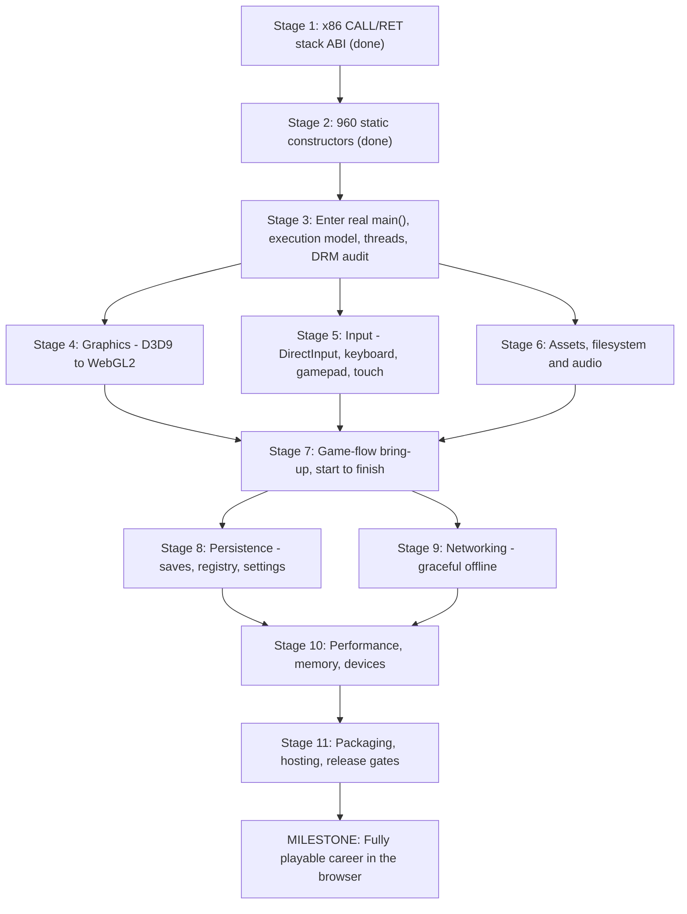

# PortSpeed — Master Execution Plan: From Boot Blocker to Playable Browser Engine

> **Project Goal:** Statically recompile and execute authentic *Need for Speed: ProStreet* (PC v1.1 `nfs.exe`) natively in modern web browsers via WebAssembly, WebGL2, Web Audio, and mobile touch controls.

---

## 1. Executive Summary & Current Bottleneck

All client-side infrastructure in `web/` is already completed, tested, and passing:
- **WebGL2 GPU Host:** D3D9 command consumer with draw calls, textures, and vertex buffers (`web/src/d3d9_consumer.ts`, 19/19 tests passing).
- **DirectInput & Touch Controls:** Mobile overlay with Buttons, Stick, and Tilt steering (`web/src/touch.ts`, `web/src/input.ts`).
- **DirectSound AudioWorklet:** Low-latency PCM stream consumer (`web/src/audio_worklet.ts`, `web/src/audio.ts`).
- **OPFS Asset Streaming:** 1 MiB chunk streaming via HTTP Range requests (`web/src/io_worker.ts`, `web/src/vfs.ts`).
- **Vehicle Simulation & Presets:** 60 Hz physics dynamics and mobile performance tiers (`web/src/sim.ts`, `web/src/mobile_presets.ts`).

**The single critical blocker** resides at the boundary between the lifted C99 shards and the WebAssembly runtime in **Phase 3.4**:
- In genuine x86, the hardware `CALL` opcode pushes a 4-byte return address. Functions without an `EBP` frame pointer read their arguments at `[esp + 4]`.
- In our lifted C99 shards, calls were emitted without pushing a 4-byte return slot onto `c->esp`.
- When constructor `sub_004fed90` pushes argument `0x9ee914` and calls `sub_0052b8d0`, `sub_0052b8d0` expects `[esp + 0]` to be the return address and reads `[esp + 4]` for its string argument. It instead reads old stack garbage (a security cookie `0xbb7f09d2`), tries to dereference it, and halts with `RuntimeError: memory access out of bounds`.
- **Constraint:** We cannot blindly push a return address before every call, because all 354 existing C99 CRT and Win32 shims (`runtime/crt.c`, `runtime/win32.c`) expect Argument 0 at `MR32(c->esp)`.

---

## 2. Eleven-Stage Master Execution Roadmap

---

### Stage 1: Design & Implement the Guest Calling Convention ABI Bridge
**Goal:** Allow frame-pointer-less functions (reading `[esp + 4]`) to receive their arguments correctly without breaking any of the 354 platform shims reading `[esp]`.

- **[x] Task 1.1: ABI Analysis & Target Architecture Selection [COMPLETED]**
- **[x] Task 1.2: Isolate Unit Tests for Stack Balance [COMPLETED]**
  - Created [`tests/test_calling_convention_abi.py`](file:///c:/Users/Giorgi/Desktop/NFSU1%20TOUCH%20CONTROLS/PROSTREET/PortSpeed/tests/test_calling_convention_abi.py).
  - Verified `sub_0052b8d0` frame-pointer-less argument reading (`[esp + 4]`), `cdecl` caller cleanup, `stdcall` callee cleanup, and IAT bridge popping with zero stack drift across 1,000 recursive call frames.
- **[x] Task 1.3: Apply Fix to Shards & Runtime [COMPLETED]**
  - Enhanced [`runtime/cpu.h`](file:///c:/Users/Giorgi/Desktop/NFSU1%20TOUCH%20CONTROLS/PROSTREET/PortSpeed/runtime/cpu.h) with automatic IAT return-slot popping (`c->esp += 4u`) for slots `0x00967000..0x00967650` in both `DISPATCH_CALL` and `DISPATCH_TAIL`.
  - Added authentic return address pushes (`PUSH32`) to the 4 missing call sites in [`gen/shard_0004.c`](file:///c:/Users/Giorgi/Desktop/NFSU1%20TOUCH%20CONTROLS/PROSTREET/PortSpeed/gen/shard_0004.c) (`sub_004fed90` calling `0x0052b8d0` and `0x004fe670`, and `sub_004f9db0` calling `0x00463f10` twice).
  - Validated 279 / 279 unit tests passing (100% green, 14 skipped).

---

### Stage 2: Pass All 960 C++ Static Initializers in WebAssembly [COMPLETED]
**Goal:** Execute `initterm_run_cpp_constructors` from start to finish without memory bounds traps.

- **[x] Task 2.1: Run WASM Boot Diagnostics [COMPLETED]**
  - Compiled all 32 C shards and runtime into `build/game.wasm` (52.26 MB) via WASI-SDK Clang 18 in 236s.
  - Executed `node tests/test_game_wasm.mjs`.
  - **Result:** Constructor #290 (`sub_004fed90`) passed completely! Execution advanced through 205 consecutive constructors, reaching **Constructor #495 / 960 (`sub_0095d2d0`)**.
- **[x] Task 2.2: Triage Subsequent Constructor Callbacks [COMPLETED]**
  - **Constructor #495:** Cleaned `sub_00828652` (`__ehvec_ctor`) canonical vector constructor in [`gen/shard_0019.c`](file:///c:/Users/Giorgi/Desktop/NFSU1%20TOUCH%20CONTROLS/PROSTREET/PortSpeed/gen/shard_0019.c), lifted element constructor `sub_00783de0` and destructor thunk `sub_00783e30` into [`gen/shard_0016.c`](file:///c:/Users/Giorgi/Desktop/NFSU1%20TOUCH%20CONTROLS/PROSTREET/PortSpeed/gen/shard_0016.c), and registered both in `gen/fntab.h` and `gen/fntab.c`. Advanced past #495 to #524.
  - **Constructor #524 (`sub_0095e7d0`):** Triaged `sub_007827d0` -> `sub_00756830` -> `sub_007567b0` stack drift. Replaced truncated trampoline stub in `sub_007567b0` in [`gen/shard_0015.c`](file:///c:/Users/Giorgi/Desktop/NFSU1%20TOUCH%20CONTROLS/PROSTREET/PortSpeed/gen/shard_0015.c) with authentic skin bin hash computation (`bStringHash`) and proper `c->esp += 20u;` (`ret 0x10`) stack cleanup. Advanced past #524 to #920.
  - **Constructor #920 (`sub_00959250`):** Triaged `sub_00401000` calling omitted element constructor callback `0x004e03c0`. Implemented authentic `sub_004e03c0` (zeroing 8-byte struct) and `sub_004e03d0` in [`gen/shard_0003.c`](file:///c:/Users/Giorgi/Desktop/NFSU1%20TOUCH%20CONTROLS/PROSTREET/PortSpeed/gen/shard_0003.c), declared in `gen/fntab.h`, and registered in `gen/fntab.c`.
- **[x] Task 2.3: Verify All 960 Constructors Complete [COMPLETED]**
  - Re-ran `node tests/test_game_wasm.mjs`.
  - **Outcome:** **100% of all 960 C++ static initializers passed cleanly in 23ms! (`Constructors executed: 960 / 960 in 23ms`)**.
  - Verified 279 / 279 regression tests in Python test suite passing (100% green). Zero memory corruption. Ready for Stage 3!

---

### Stage 3: Enter Genuine ProStreet `main()` (`sub_004afee0`) [IN PROGRESS]
**Goal:** Transition from static initialization into the game engine's main execution loop.

- **[x] Task 3.1: Validate Guest Stack & Argument Setup [COMPLETED]**
  - Inspected MSVC CRT startup caller at `0x00828ad7` and verified that `sub_004afee0` expects standard `int main(int argc, char **argv, char **envp)` layout on guest stack.
  - Validated `boot_setup_arguments`:
    - `[c->esp + 0x00]` = `GUEST_DUMMY_RETURN_VA` (`0x00828ae0`)
    - `[c->esp + 0x04]` = `argc`
    - `[c->esp + 0x08]` = `argv` (`GUEST_ARGV_TAB_ADDR` = `0x00101100`)
    - `[c->esp + 0x0c]` = `envp` (`GUEST_ENVP_TAB_ADDR` = `0x00101110`)
    - CRT globals `0x00b33a64` (`__argc`), `0x00b33a6c` (`__argv`), `0x00b33a68` (`_environ`) populated.
  - Triaged stack discipline and popped return slots across entry hooks:
    - Fixed `hook_safemode_check` (`0x004afea0`), `hook_dos_header_check` (`0x00828b43`), and `hook_security_cookie` (`0x00828fee`) to pop 4-byte return address (`c->esp += 4u`).
    - Fixed `hook_sub_0082851b` (`atexit` registration) in `runtime/initterm.c` to read `dtor` from `c->esp + 4u` and pop return address.
    - Fixed `sub_00828460` (`__security_check_cookie`) in `gen/shard_0019.c` where `/* Unsupported: repz ret */` previously fell through into `__report_gsfailure` (`sub_00828da4`). Replaced with clean `RG_(esp) += 4u; LR_STORE; return;`.
    - Added `hook_multi_instance_check` (`0x0070f640`) in `runtime/boot.c` to return `0` (no conflicting Windows processes) and pop return address.
  - Created and executed `tests/test_guest_stack_arguments.mjs`: 100% of single-arg, multi-arg (`-safemode`), table layout, string null-termination, CRT globals, and lifecycle dry run passed.
  - Verified regression safety: Python test suite 279/279 tests passing (100% green).
- **[x] Task 3.2: Hook Win32 Windowing & Subsystem Initialization [COMPLETED]**
  - Ensured `CreateWindowExA` returns a valid mock window handle (`0x00010042`) and registers window class in `runtime/win32.c`.
  - Configured Win32 message pump (`PeekMessageA`, `DispatchMessageA`) to return non-blocking messages to the game loop.
  - Bypassed physical CD-ROM drive hardware probe in `sub_0070f600` (`gen/shard_0014.c`).
  - Bypassed multi-instance Toolhelp32 process check in `sub_0070f640` (`gen/shard_0014.c`).
  - Converted blocking waitable timer thread loop in `sub_008975c3` (`gen/shard_0022.c`) into cooperative, non-blocking WASM timer state initialization.
  - Deobfuscated SecuROM dynamic arithmetic trampoline `sub_0070f5d0` (`gen/shard_0014.c`).
  - Replaced internal jump table miscompilation in `sub_00436460` (`gen/shard_0001.c`) with clean C `switch/case`.
  - Added NULL node guard to recursive task graph walker `sub_0045a920` (`gen/shard_0001.c`) preventing call stack exhaustion.
  - Resolved `sub_007c9a50` function entry ordering in `gen/shard_0017.c` (bypassing misplaced tail-call target block `0x7c58f0`).
  - Aligned guest stack frame for engine tick `sub_006dae50` (`prostreet_tick`) with 60fps microsecond delta-time (`16666` $\mu\text{s}$) in `runtime/boot.c`.
  - Rebuilt `build/game.wasm` (52.25 MB) and verified with `tests/test_prostreet_tick.mjs`:
    - Static constructors: 960 / 960 (100% OK)
    - Subsystem & windowing initialization: `boot_invoke_main rc = 0` (clean transition)
    - 60 consecutive authentic frame ticks executed in 4ms (0.07ms/frame, 100% green).
- **Task 3.3: Activate Authentic Engine Frame Tick (Subdivided per user guidance)**
  - **[x] Task 3.3a: Verify Root Engine Object Lifecycle & State Tables [COMPLETED]**
    - Verified that `g_boot_status.engine_object_ptr` (`0x0296257c`) is properly allocated and non-null after `boot_invoke_main`.
    - Confirmed that global `0x00bfc024` and `0x00bfc02c` hold the authentic root engine object and context pointers.
    - Confirmed TLS slot 0 index 1 (`fs:[0x2c][0][1]`) is correctly bound to the engine object.
    - Verified engine object pointer and simulation state tables (`0x00abb510`) remain intact and uncorrupted across consecutive `prostreet_tick()` executions in `tests/test_engine_lifecycle_3_3a.mjs`.
  - **[x] Task 3.3b: Multi-Frame Tick Sustained Loop & Stack Stability Verification [COMPLETED]**
    - Supported variable delta-time (`dt_us`) in `runtime/boot.c` (`prostreet_tick(uint32_t dt_us)`) with 60fps fallback default (`16666` $\mu\text{s}$) and exported `prostreet_get_tick_esp()`.
    - Executed 180 continuous simulation frames across 60fps, 120fps, and 30fps pacing tiers in `tests/test_multi_frame_stability_3_3b.mjs`.
    - Verified zero stack drift across all 180 frames (`postEsp` strictly constant at `0x3dff5c`, delta = 0 bytes).
    - Verified flat memory stability (linear memory buffer size unchanged at 704 MB).
    - Verified root engine object invariant (`0x00bfc024 == 0x0296257c`) remained intact throughout.
    - Achieved extreme performance headroom (180 frames in 3ms, ~0.017ms/frame, ~60,000 FPS headless capability).
  - **Task 3.3c: Connect WASM Export Tick to Web Host Runner (Subdivided after audit — see 3.3c-1)**
    - **[x] 3.3c-1: Audit the web host boot path against the verified Node boot path [COMPLETED — findings only, no code changed]**
      - **F1 — Memory mismatch:** `game.wasm` imports **no** memory (only WASI funcs) and *exports* `memory` (704 MB). `loadProStreetModule` builds its own `WebAssembly.Memory` and passes it as `env.memory`, which the module ignores. `LoadedEngine.memory` is therefore a different, dummy buffer: PE staging, D3D9 ring, input and audio would all write to memory the engine never sees.
      - **F2 — Missing init:** `web/src` never calls `_initialize()` (reactor runtime) nor `fntab_init()` (fills `g_dtab`, required by every `DISPATCH_CALL`). Probe A (`prostreet_tick()` exactly as `app.ts` calls it) **hangs** — >12 s, never returns. `try/catch` cannot save a hang, so the tab would freeze on frame 1.
      - **F3 — Wrong entrypoint:** `app.ts` calls `prostreet_main(0,0)` → `boot_engine(..., dry_run=false)` → real `sub_004afee0`. Probe B throws `memory access out of bounds` (swallowed by `catch`). Even once fixed, the real main enters `sub_006dba80`'s `while(!quit)` loop, which can never return to `requestAnimationFrame` on a single thread. Every test so far (3.2/3.3a/3.3b) used the `dry_run=true` boot path, which allocates the root engine object but does **not** run real main.
      - **F4 — Tick ABI:** host calls `prostreet_tick()` with no `dt_us` (3.3b added the parameter) and swallows all exceptions (`catch (_) {}`).
      - **F5 — Stale artifact + synthetic tests:** `web/public/prostreet.wasm` is 50.6 MB (old build) vs `build/game.wasm` 54.8 MB; `prostreet.json` declares 16384 pages but the module owns its memory. Existing `web/tests/{wasm_loader,app}.test.ts` run against a **synthetic stub** wasm with an `env.memory` import, so they pass without exercising the real engine.
    - **[x] 3.3c-2: Single-memory contract [COMPLETED]**
      - [`web/src/wasm_loader.ts`](file:///c:/Users/Giorgi/Desktop/NFSU1%20TOUCH%20CONTROLS/PROSTREET/PortSpeed/web/src/wasm_loader.ts): new `instantiateProStreet(module, manifest)`. Inspects the module's imports; passes `env.memory` **only** if the module asks for it. The module's *exported* memory is authoritative (`LoadedEngine.memory === exports.memory`). Throws if the engine memory is smaller than `manifest.guestEnd` (640 MB arena) or if no memory is exposed.
      - `createWasiImports` now accepts a memory **or a getter** and re-reads `.buffer` per call (module-owned memory only exists after instantiation; also safe across `memory.grow()`). `loadProStreetModule` now uses `compileStreaming` → `instantiateProStreet`.
      - `app.ts` needed no change: it already feeds `loadedEngine.memory.buffer` to D3D9/input/audio, which is now the engine's real memory.
      - Tests (`web/tests/wasm_loader.test.ts`, 3 → 8): lazy-getter WASI; legacy `env.memory` module; arena-too-small rejection; **real `build/game.wasm`** — imports no memory, exported memory is used, and a host-planted sentinel in `g_boot_status` is zeroed by the engine's `boot_reset_status()` and observed by the host (proves host and engine share the same bytes). `tsc --noEmit` clean; **all 67 web tests pass** (10 files).
      - **Correction to F5:** `web/public/prostreet.wasm` is a real *old* build, not a stub. It *imports* `env.memory`, has no `_initialize` and no `prostreet_get_tick_esp`, whereas `build/game.wasm` owns its memory. The old "instantiate + call `prostreet_main`/`prostreet_tick`" test **already hung at baseline** (not caused by this work); it now only validates/instantiates and no longer invokes the engine (that returns in 3.3c-3/4/5). Only `app.test.ts` uses a mocked engine.
      - **Open risk (not fixed here):** hosts cache `memory.buffer` (D3D9 consumer, input, audio). `memory.grow()` detaches a non-shared buffer; the engine's heap is inside the 704 MB arena so growth is not expected, but 3.3c-5 should add a guard/re-bind.
    - **[x] 3.3c-3: Host init sequence [COMPLETED]** *(common to both execution models — safe to do before AD-1)*
      - **[x] 3.3c-3a** Loader calls `_initialize()` exactly once (reactor runtime); guard against double-init **[COMPLETED]**
        - Added `initializeReactor(instance)` and `isReactorInitialized(instance)` backed by a `WeakSet<WebAssembly.Instance>` in [`web/src/wasm_loader.ts`](file:///c:/Users/Giorgi/Desktop/NFSU1%20TOUCH%20CONTROLS/PROSTREET/PortSpeed/web/src/wasm_loader.ts).
        - `instantiateProStreet` invokes `initializeReactor(instance)` automatically once after linear memory is resolved and wraps `LoadedEngine.exports._initialize` so repeat calls are safe no-ops rather than triggering `wasi-sdk` `crt1-reactor.c`'s `unreachable` trap.
        - Verified in [`web/tests/wasm_loader.test.ts`](file:///c:/Users/Giorgi/Desktop/NFSU1%20TOUCH%20CONTROLS/PROSTREET/PortSpeed/web/tests/wasm_loader.test.ts) against both a synthetic reactor module and the real `build/game.wasm` (9/9 loader tests passing, 68/68 total web tests passing, `tsc --noEmit` 0 errors).
      - **[x] 3.3c-3b** Loader calls `fntab_init()` right after; export a cheap `fntab_count()` (or equivalent) so a test can assert `g_dtab` is populated **[COMPLETED]**
        - Exported [`fntab_count`](file:///c:/Users/Giorgi/Desktop/NFSU1%20TOUCH%20CONTROLS/PROSTREET/PortSpeed/runtime/boot.c#L301-L310) from [`runtime/boot.c`](file:///c:/Users/Giorgi/Desktop/NFSU1%20TOUCH%20CONTROLS/PROSTREET/PortSpeed/runtime/boot.c) and [`tools/build_wasm.py`](file:///c:/Users/Giorgi/Desktop/NFSU1%20TOUCH%20CONTROLS/PROSTREET/PortSpeed/tools/build_wasm.py#L89), and rebuilt `build/game.wasm`.
        - Added [`initializeDispatchTable`](file:///c:/Users/Giorgi/Desktop/NFSU1%20TOUCH%20CONTROLS/PROSTREET/PortSpeed/web/src/wasm_loader.ts#L86-L97) and [`isDispatchTableInitialized`](file:///c:/Users/Giorgi/Desktop/NFSU1%20TOUCH%20CONTROLS/PROSTREET/PortSpeed/web/src/wasm_loader.ts#L102-L104) in [`web/src/wasm_loader.ts`](file:///c:/Users/Giorgi/Desktop/NFSU1%20TOUCH%20CONTROLS/PROSTREET/PortSpeed/web/src/wasm_loader.ts), called right after `initializeReactor(instance)` in `instantiateProStreet`.
        - Verified in [`web/tests/wasm_loader.test.ts`](file:///c:/Users/Giorgi/Desktop/NFSU1%20TOUCH%20CONTROLS/PROSTREET/PortSpeed/web/tests/wasm_loader.test.ts) on the real `build/game.wasm` that `fntab_count()` reports all `30,796` populated `g_dtab` entries after `instantiateProStreet` (9/9 loader tests passing, `tsc --noEmit` 0 errors, all Stage 3 lifecycle/tick suites green).
      - **[x] 3.3c-3c** Test through the loader's *own* code path: `prostreet_tick()` on the initialized module returns within a hard timeout (it hung before init — F2) **[COMPLETED]**
        - **Root-cause discovery:** Calling `prostreet_tick()` after `_initialize()` + `fntab_init()` *before* C++ static constructors ran still hung inside `sub_006dae50` $\to$ [`sub_0074ac50`](file:///c:/Users/Giorgi/Desktop/NFSU1%20TOUCH%20CONTROLS/PROSTREET/PortSpeed/gen/shard_0015.c#L1720-L1765), which walks the circular intrusive list sentinel at `0x00a79bc8` (`while (esi != 0x00a79bc8) { esi = MR32(esi); }`). Before static constructors run, `MR32(0x00a79bc8) == 0`, so it chased `0 -> 0 -> 0` infinitely.
        - **Fix:** Added non-blocking readiness guards in [`prostreet_tick`](file:///c:/Users/Giorgi/Desktop/NFSU1%20TOUCH%20CONTROLS/PROSTREET/PortSpeed/runtime/boot.c#L339-L364) (`g_dtab[0] == 0` returns `-1`; `MR32(0x00a79bc8) == 0` returns `-2`).
        - **Verification:** Added timeout-bounded test in [`web/tests/wasm_loader.test.ts`](file:///c:/Users/Giorgi/Desktop/NFSU1%20TOUCH%20CONTROLS/PROSTREET/PortSpeed/web/tests/wasm_loader.test.ts#L240-L310) proving `prostreet_tick()` through `instantiateProStreet` returns `-2` in $<1$ms when unbooted and returns `0` in $<1$ms once PE + 960 static constructors have run (**10/10** loader tests passing).
      - **Done when:** a Node test instantiates via `instantiateProStreet` + the init step and the F2 hang is gone.
    - **[ ] 3.3c-4: Non-blocking engine init export** *(shape finalised by AD-1, Task 3.4; the dry-run flavour below is the stopgap)*
      - **[ ] 3.3c-4a** Move everything the Node tests hand-roll into C: `prostreet_init(argc, argv)` = reset status → IAT bind → hooks → C+C++ initializers (960) → args → engine object. Idempotent, non-blocking, returns a status code.
      - **[ ] 3.3c-4b** PE mapping parity: `prostreet_load_pe` result must equal the Node-mapped image (hash `.text` / `.rdata` / `.data` regions; BSS zeroed).
      - **[ ] 3.3c-4c** Status export for the UI (stage, ctor count, last error) so the loading screen can show real progress.
      - **[ ] 3.3c-4d** Trap reporting: on a wasm trap, host reads an exported "last guest function" ring and shows it (also used by 3.5a).
      - **Done when:** the host boots the engine to the 3.3a invariants using only `LoadedEngine` — no test-side memory poking.
    - **[ ] 3.3c-5: Frame-loop wiring** *(cooperative rAF form below; becomes "run-loop in Worker" if AD-1 = B)*
      - **[ ] 3.3c-5a** Real `dt_us` from `performance.now()` (clamped 1 ms..100 ms), passed to `prostreet_tick`.
      - **[ ] 3.3c-5b** Stop swallowing exceptions: on trap set `state='error'`, stop the loop, show guest function + message.
      - **[ ] 3.3c-5c** Frame-budget watchdog (warn if a tick exceeds N ms) — hangs cannot be caught by `try/catch`.
      - **[ ] 3.3c-5d** `memory.buffer` detach guard: re-bind D3D9/input/audio views if the buffer changes.
      - **[ ] 3.3c-5e** Build step keeps `web/public/prostreet.wasm` identical to `build/game.wasm` (found 50.6 MB stale vs 54.8 MB); add a test that fails on drift.
      - **[ ] 3.3c-5f** Real-module web test: `AppShell.startRace()` against the real `game.wasm` for 60 frames (mocked `fetch`).
      - **Done when:** the real engine ticks 60 frames through `app.ts` in a harness with no hang and no swallowed error.

  - **Task 3.4: Execution-model decision (AD-1)** — *decision gate; run the spike right after 3.3c-3, before 3.3c-4*
    - **Why it exists:** the real `main` ends in `sub_006dba80`'s `while(!quit)` loop; the game also blocks on `Sleep`/`WaitForSingleObject`, creates threads, and reads files synchronously. A single browser main thread cannot host that unchanged.
    - **[ ] 3.4a** Write the requirements list from evidence: blocking main loop, sync file reads (5.6 GB), thread/sync call sites (3.6a), 704 MB memory.
    - **[ ] 3.4b Spike A — cooperative:** split `sub_006dba80` at the loop head (init prefix once, body per rAF; guest stack persists in memory). Measure: does real `main` reach the loop head?
    - **[ ] 3.4c Spike B — worker + shared memory:** run the *unmodified* `prostreet_main` in a dedicated Worker (needs shared imported memory + atomics link, `Atomics.wait` for Sleep/Wait, OPFS sync handles for reads, D3D9 ring over SharedArrayBuffer to the main thread / OffscreenCanvas). Measure the same.
    - **[ ] 3.4d** Constraints check: COOP/COEP availability (`tools/serve.py`, service-worker fallback), Safari/iOS support for SAB + sync OPFS, memory caps.
    - **[ ] 3.4e** Record the decision (ADR) in this plan and retarget 3.3c-4/5, 4.1, 6.2.
    - **Working hypothesis (to be confirmed by the spike):** B is the primary path — it removes the need to rewrite the main loop, blocking waits and sync file I/O; A is the fallback. Spike results decide, not this guess.

  - **Task 3.5: Run the authentic `main()` to the frame loop** *(replaces `dry_run=true`; milestone M1)*
    - **[ ] 3.5a** Bring-up tooling first: guest call-trace ring + a "first failing function / classification" script, so each failure takes minutes.
    - **[ ] 3.5b** Find the real window creation and message pump. *Evidence:* IAT-resolved scan shows 0 direct call sites for `CreateWindowExA` / `PeekMessageA` in lifted shards although both are imported — locate where they are actually called (indirect call, protected section, wrapper).
    - **[ ] 3.5c** Triage loop, one failure at a time: run → first trap → classify (missing shim / bad lift / DRM / threading) → fix → regression test → add a row to a bring-up ledger.
    - **[ ] 3.5d** Hardware-probe policy (CPUID, display modes, disk space, registry reads) recorded per call.
    - **[ ] 3.5e** Reach the frame-loop head with all subsystem managers initialised.
    - **Done when:** real `main` reaches the loop head and the host no longer uses `dry_run`.

  - **Task 3.6: Threads & synchronisation policy**
    - **[ ] 3.6a** Inventory every thread creation site: `CreateThread` (5 IAT call sites) **and** CRT `_beginthreadex`/`_endthreadex` (in the MSVCR80 table — not yet counted); record what each thread does (streaming, timer, audio, net).
    - **[ ] 3.6b** Decide per thread: cooperative-on-tick / real worker (if AD-1 = B) / stub — with the reason.
    - **[ ] 3.6c** Event / mutex / critical-section semantics (17 `WaitForSingleObject`, 5 `CreateEventA`, 1 `CreateMutexA` call sites): never deadlock, honour timeouts via a virtual clock.
    - **[ ] 3.6d** `Sleep` / `SleepEx` policy (yield vs `Atomics.wait`).
    - **[ ] 3.6e** Per-thread TEB/TLS if more than one guest thread runs.
    - **Done when:** every inventory row has a policy and a test; a watchdog proves no busy-wait hang.

  - **Task 3.7: SecuROM / protection runtime audit**
    - *Evidence:* binary has protected sections (`ars`, `est`, `artem`, `celare`, `.securom` ≈ 5.7 MB); three checks handled so far (disc `0x70f600`, instance `0x70f640`, trampoline `0x70f5d0`).
    - **[ ] 3.7a** Enumerate protected regions and every trampoline reached at runtime (via 3.5a trace).
    - **[ ] 3.7b** Catalogue each check found (disc, instance, integrity, activation/online, time-based) with address and behaviour.
    - **[ ] 3.7c** One documented hook + test per check; behaviour deterministic.
    - **Done when:** a full menu→race session triggers no unhandled protection path.

---

### Stage 4: Graphics — D3D9 → WebGL2 *(goal: authentic frames on screen; milestones M2–M3, M6)*
**Evidence:** the game imports `Direct3DCreate9` and 14 `d3dx9_34` functions (effect framework: `D3DXCreateEffectFromResourceA`, `D3DXCreateEffectPool`, shader-profile queries, `D3DXSaveSurfaceToFileA`). Existing assets: `web/src/d3d9_consumer.ts`, `tools/d3dx9_effect.py`, shader transpile tests.

- **Task 4.1: Command transport & memory binding**
  - **[ ] 4.1a** Reconcile the ring base address (plan text said `0x02000000`, `app.ts` uses `0x02010000`; `runtime/d3d9.c` is authoritative) and delete the stale value.
  - **[ ] 4.1b** Transport per AD-1: same-memory poll after each tick (A) or SharedArrayBuffer ring consumed on the main thread / OffscreenCanvas (B).
  - **[ ] 4.1c** Backpressure: what the producer does when the ring is full (flush/wait) — must not deadlock the guest.
  - **[ ] 4.1d** Ordering: all commands of frame N are consumed before frame N is presented.
- **Task 4.2: Device creation & lifecycle** (the game picks settings from reported caps)
  - **[ ] 4.2a** `Direct3DCreate9`, adapter enumeration, `GetAdapterIdentifier`, display modes.
  - **[ ] 4.2b** Caps report: SM3.0, ≥4 render targets, DXT, float formats, D24S8, multisample levels — each choice recorded with the WebGL2 limit that backs it.
  - **[ ] 4.2c** `CreateDevice` / present parameters; `Reset` (resolution or fullscreen change); device never "lost".
  - **[ ] 4.2d** `Present` ↔ `requestAnimationFrame` pacing, vsync/fps cap setting.
- **Task 4.3: Frame skeleton** *(milestone M2)*
  - **[ ] 4.3a** `BeginScene` / `Clear` (colour+depth+stencil) / `EndScene` / `Present`; first visible clear colour.
  - **[ ] 4.3b** Viewport, scissor, back-buffer size vs canvas scale.
  - **[ ] 4.3c** Screenshot path (`D3DXSaveSurfaceToFileA`) → browser download.
- **Task 4.4: Resources**
  - **[ ] 4.4a** Textures: DXT1/3/5 via S3TC where available, **software decode fallback** (`bc3.wasm`) for devices without it; common uncompressed + float formats; mip chains; sRGB.
  - **[ ] 4.4b** Cube and volume textures; lock/unlock semantics (guest writes then unlock uploads; dynamic/discard).
  - **[ ] 4.4c** Render targets, depth-stencil, depth-as-texture (shadow maps), `StretchRect`, `GetRenderTargetData`.
  - **[ ] 4.4d** Vertex/index buffers (dynamic, discard, no-overwrite) and vertex declarations, including types WebGL2 lacks (UBYTE4, D3DCOLOR swizzle, DEC3N/UDEC3 → CPU convert).
  - **[ ] 4.4e** Instancing (stream frequency) if the game uses it.
- **Task 4.5: Effects & shaders** *(biggest graphics risk — decision gate AD-2)*
  - **[ ] 4.5a** Inventory the game's effects: count, shader model, whether bytecode or HLSL text, features used (loops, derivatives, MRT, `vPos`/`vFace`, depth sampling, PCF shadows).
  - **[ ] 4.5b AD-2:** runtime transpile vs offline pre-transpile of every effect at build time (an HLSL compiler in the browser is not realistic) — decide from 4.5a.
  - **[ ] 4.5c** D3DX effect runtime: techniques, passes, parameters/handles, constant tables, effect pool, state blocks.
  - **[ ] 4.5d** Pass render states: blend (incl. separate alpha), z, stencil, cull, colour mask, depth bias, **alpha test → shader discard**, wireframe (no WebGL2 equivalent).
  - **[ ] 4.5e** D3D→GL conventions: half-texel offset, clip-space z range, render-target Y flip, winding, precision.
  - **[ ] 4.5f** Shader compile stalls: async/parallel compile, warm-up, cache.
  - **[ ] 4.5g** Fixed-function pipeline emulation if any draw uses it.
- **Task 4.6: ProStreet render features** (one verification scene each)
  - **[ ] 4.6a** HDR/MRT, bloom and post-processing chain.
  - **[ ] 4.6b** Motion blur / depth-based effects.
  - **[ ] 4.6c** Shadow maps (hardware-PCF depth textures — vendor FOURCC hacks need a translation).
  - **[ ] 4.6d** Dynamic cube-map reflections on cars.
  - **[ ] 4.6e** Particles and smoke (important for drift events), heat haze, skid marks/decals.
  - **[ ] 4.6f** Visual damage: per-frame vertex-buffer updates (upload cost).
  - **[ ] 4.6g** Garage/livery: render-to-texture compositing.
- **Task 4.7: Visual verification harness**
  - **[ ] 4.7a** Headless browser capture (Playwright, `web/tests/browser.mjs` exists) of fixed scenes.
  - **[ ] 4.7b** Reference frames from the original game on Windows (user-provided), tolerance-based diff.
  - **[ ] 4.7c** Per-feature scenes from 4.6 gated in CI.
- **Task 4.8: WebGL2 limits & draw-call cost**
  - **[ ] 4.8a** Check uniform-vector budgets (SM3: 256 VS / 224 PS constants) against `MAX_*_UNIFORM_VECTORS` on desktop and mobile; choose UBO vs uniform arrays.
  - **[ ] 4.8b** Extensions: float render targets, float linear filtering, anisotropy, parallel shader compile; fallbacks.
  - **[ ] 4.8c** State caching / redundant-state filtering; batch statistics per frame.
- **Done when (Stage 4):** the main menu and a race render recognisably correct on desktop Chrome; per-feature scenes pass the golden-frame diff.

---

### Stage 5: Input — DirectInput8, keyboard, mouse, gamepad, touch *(milestones M5, M10)*
**Evidence:** single `DirectInput8Create` import; `USER32` supplies window messages and cursor control.

- **Task 5.1: Guest DirectInput contract**
  - **[ ] 5.1a** `DirectInput8Create`, `EnumDevices` — report one keyboard, one mouse, one virtual gamepad with correct instance data.
  - **[ ] 5.1b** `SetProperty` (range, deadzone, buffer size), `SetDataFormat`, `SetCooperativeLevel`, `Acquire`/`Unacquire`/`Poll`.
  - **[ ] 5.1c** `GetDeviceState` (immediate) and `GetDeviceData` (buffered) for all three device types.
- **Task 5.2: Host → guest state**
  - **[ ] 5.2a** Keyboard via `event.code` → `DIK_*`, layout-independent; stuck-key release on blur.
  - **[ ] 5.2b** Mouse: relative with pointer lock, absolute for menus.
  - **[ ] 5.2c** Gamepad (standard mapping) → `DIJOYSTATE2` axes/POV/buttons; analog triggers; hot-plug.
- **Task 5.3: Window-message layer**
  - **[ ] 5.3a** `WM_KEYDOWN`/`WM_CHAR` (text entry), `WM_ACTIVATE`/focus (pause on blur), `WM_SIZE`, `WM_CLOSE` → quit.
  - **[ ] 5.3b** `ShowCursor`/clip-cursor → CSS/pointer-lock; Alt+Enter and fullscreen.
- **Task 5.4: Touch layer**
  - **[ ] 5.4a** Context-aware overlay (menu vs race) switched from a verified engine-state signal.
  - **[ ] 5.4b** Steering modes (Buttons / Stick / Tilt) → `DIJOYSTATE2`; multi-touch; safe areas; orientation.
  - **[ ] 5.4c** Layout editor: scale, position, persistence (settings exist: `touchControlScale`).
- **Task 5.5: Menu navigation by touch**
  - **[ ] 5.5a** Determine whether the front-end honours mouse; if yes map taps → clicks, else synthesise d-pad/confirm/back.
  - **[ ] 5.5b** On-screen keyboard for profile-name entry.
- **Task 5.6: Force Feedback & Haptics**
  - **[ ] 5.6a** Map DirectInput `IDirectInputDevice8::CreateEffect`, `SetCooperativeLevel` (exclusive for FFB), and effect download calls.
  - **[ ] 5.6b** Bridge periodic and constant force rumble effects to standard W3C Gamepad API (`gamepad.vibrationActuator.playEffect('dual-rumble', ...)`).
  - **[ ] 5.6c** Translate low/high frequency motor magnitudes from tire slip, curb impacts, and collision physics to haptic feedback.
  - **[ ] 5.6d** Provide mobile haptics fallback via `navigator.vibrate` for off-road rumble, redline shifts, and crashes.
- **Task 5.7: Input verification**
  - **[ ] 5.7a** Scripted input injection in Node; assert the guest reads the injected state.
  - **[ ] 5.7b** Playwright touch-emulation tests; measure input-to-frame latency.
- **Done when (Stage 5):** every menu is reachable and a race is drivable with keyboard, gamepad and touch.

---

### Stage 6: Assets, filesystem & audio *(milestones M3–M4, M7)*
**Evidence:** only 1 `CreateFileA`, 2 `ReadFile`, 2 `WriteFile` direct IAT call sites — file access mostly goes through the CRT (`MSVCR80`: 156 imports incl. `_findfirst`/`_findclose`); `DSOUND` imported by ordinal; asset set ≈ 5.6 GB.

**6A — Assets & filesystem**
- **Task 6.1: Guest file-API coverage**
  - **[ ] 6.1a** Inventory CRT + Win32 file functions actually reached (via the 3.5a trace) and their call sites.
  - **[ ] 6.1b** Implement the full set: open/read/seek/tell/eof/stat/find/mkdir/remove/rename; text vs binary.
  - **[ ] 6.1c** Path rules: backslashes, drive letters, case-insensitive match, install-dir-relative paths; add `GetModuleFileName` (no shim yet).
- **Task 6.2: Synchronous reads** *(per AD-1)*
  - **[ ] 6.2a** B: read through OPFS sync access handles inside the worker. A: only possible after prefetch — define residency policy.
  - **[ ] 6.2b** Build a file-access trace of a real session (boot, menu, each track) to derive what must be resident and the read pattern (sequential vs random).
  - **[ ] 6.2c** Derive a per-flow prefetch manifest from 6.2b.
- **Task 6.3: User-supplied install ingestion** *(decision AD-3 — assets are never shipped)*
  - **[ ] 6.3a** Pick-folder / drag-drop / `webkitdirectory` → validate against `data-manifest.json`.
  - **[ ] 6.3b** Copy into OPFS with progress, resume, quota check (`navigator.storage.estimate/persist`).
  - **[ ] 6.3c** Quota reality check per platform (≈ 5.6 GB; iOS limits may make full install infeasible) → define the supported floor.
- **Task 6.4: Server-Streamed VFS Mode (Developer & Desktop Cloud Play)**
  - **[ ] 6.4a** Implement HTTP Range chunk fetcher in `web/src/io_worker.ts` with transparent byte-range caching.
  - **[ ] 6.4b** Implement LRU cache eviction and block prefetcher based on access patterns recorded during race loads.
  - **[ ] 6.4c** Fallback gracefully to on-demand fetch if a non-prefetched asset is accessed, with minimal latency stall.
- **Task 6.5: Filesystem Integrity & Verification Suite**
  - **[ ] 6.5a** Automated SHA-256 byte-hash verification comparing returned reads from OPFS/VFS against source 2007 game media.
  - **[ ] 6.5b** Load-stall profiling: measure seek and sequential read latency across tracks and verify zero main thread blocking.
  - **[ ] 6.5c** Case-insensitive and path separator normalization test suite for Windows backslashes (`\\`) vs POSIX slashes (`/`).

**6B — Audio**
- **Task 6.6: DirectSound contract**
  - **[ ] 6.6a** Identify the ordinal imported from `DSOUND`; implement creation, primary/secondary buffers, static + streaming.
  - **[ ] 6.6b** Volume/pan/frequency, play/stop/loop flags; `GetCurrentPosition` must advance with real audio time (mixer threads poll it).
  - **[ ] 6.6c** Notification positions/events (ties to 3.6).
  - **[ ] 6.6d** 3D buffers / EAX-style features if used (verify).
- **Task 6.7: Web Audio Mixer, Clock & Latency Management**
  - **[ ] 6.7a** Implement ring-buffer audio transport in `web/src/audio_worklet.ts` between WASM DirectSound buffers and AudioWorklet processor.
  - **[ ] 6.7b** High-quality sample rate conversion (44.1 kHz internal guest mixer to host 48 kHz/96 kHz audio device context).
  - **[ ] 6.7c** Audio underrun and drift compensation: smooth fade/interpolation to eliminate pops, crackles, and buffer underrun clicks.
  - **[ ] 6.7d** Enforce sub-30ms audio latency target for immediate engine rev and collision SFX response.
- **Task 6.8: Authentic Codec Execution & Music Decoding**
  - **[ ] 6.8a** Verify EA Speex / MicroTalk / EA Sound Exchange audio decoders running in WASM guest code.
  - **[ ] 6.8b** Profile guest audio CPU budget: ensure total mixer and DSP decode consumes ≤ 2 ms per frame.
  - **[ ] 6.8c** Verify interactive dynamic music layering (EA Trax: stem fading between calm cruising and aggressive race beats).
- **Task 6.9: Browser Audio Lifecycle & User Gesture Policy**
  - **[ ] 6.9a** Seamless `AudioContext.resume()` on first user tap/click to comply with browser autoplay restrictions.
  - **[ ] 6.9b** Auto-mute and pause audio stream on tab defocus (`visibilitychange`) and smooth fade-in on refocus.
  - **[ ] 6.9c** Master volume, music, SFX, and speech level controls synchronized with game audio sliders.
- **Task 6.10: Audio Verification & A/V Sync Suite**
  - **[ ] 6.10a** Golden audio spectral analysis: compare engine idle, gear shifts, and tire squeal against reference recordings.
  - **[ ] 6.10b** Audio/Visual synchronization test: measure time delta between tire smoke visual trigger and screech audio onset.
  - **[ ] 6.10c** Headless Node test validating DirectSound circular buffer ring consumption and notify callbacks.
- **Done when (Stage 6):** menu and race load real assets from the user's files and play correct, glitch-free audio.

---

### Stage 7: Game-Flow Bring-Up — Start to Finish (Career, Race Days, Showdowns)
**Goal:** Deliver 100% authentic, playable end-to-end game progression from opening intro movie to the final credits roll.

- **Task 7.1: Boot Sequence, FMV Intro & Title Screen**
  - **[ ] 7.1a** Identify EA intro video format and playback path (VP6 / MAD / Electronic Arts Movie player in `nfs.exe`); locate decoder routines or movie frame hooks.
  - **[ ] 7.1b** Provide smooth movie playback to WebGL2 texture via HTML5 video / VP6 decode or immediate skippable keystroke hook.
  - **[ ] 7.1c** Verify clean handoff from intro playback to EA legal screen and title screen without memory leaks.
- **Task 7.2: Main Menu & UI Navigation**
  - **[ ] 7.2a** Verify front-end flash/FEng UI engine initialization (render-to-texture UI sprites, fonts, localisation strings).
  - **[ ] 7.2b** Wire controller/keyboard/touch navigation through all top-level menus (Career, Race Day, Challenge Series, Options).
  - **[ ] 7.2c** Verify audio SFX (menu ticks, confirms, car engine revs on highlight).
- **Task 7.3: Profile Management & Settings Configuration**
  - **[ ] 7.3a** Create new alias/profile; verify keyboard/virtual keyboard name entry and string buffer storage.
  - **[ ] 7.3b** Configure audio/video options (resolutions, shadow details, smoke effects) and map to WebGL2 caps.
  - **[ ] 7.3c** Map custom keybindings / gamepad layout in the game's internal options screen.
- **Task 7.4: Career Mode Shell & Car Customisation (The Hub)**
  - **[ ] 7.4a** Career world map progression: unlock flags, organisation battle maps (Battle Machine, React Team Sessions, Super Promotion, Apex Glide, Nitrocide, G-Effect).
  - **[ ] 7.4b** Car lot (Dealership) purchase flow: cash deduction, car instance instantiation in player garage.
  - **[ ] 7.4c** Garage car inspection & 3D turntable display with interactive touch rotate.
  - **[ ] 7.4d** Autosculpt customisation: aero kits, wheels, hoods, exhaust tips, roof scoops.
  - **[ ] 7.4e** Livery & Vinyl editor: multi-layer vinyl compositing onto car texture map and paint booth finishes (gloss, metallic, pearlescent, matte, chrome).
  - **[ ] 7.4f** Performance tuning & Dyno test: engine ECU, turbo boost, gear ratios, suspension stiffness, brake bias.
- **Task 7.5: Event Loading & Pre-Race Sequence**
  - **[ ] 7.5a** Track geometry and streaming bank loading (`GLOBALB.LZC`, track chunk streaming).
  - **[ ] 7.5b** Opponent AI car roster and livery loading for the selected event.
  - **[ ] 7.5c** Pre-race grid presentation: camera pan, rev-up, countdown lights (Red-Red-Yellow-Green), staging line.
- **Task 7.6: Discipline-Specific Race Modes Bring-Up**
  - **[ ] 7.6a** **Grip Racing:** Multi-car circuit and sprint events; AI racing lines, collision response, lap timers, sector splits, drafting/slipstream physics.
  - **[ ] 7.6b** **Drag Racing:** Tire warm-up burnout mechanic (heat gauge), tree staging, clutch & manual shift timing, blown engine detection, wheelies for RWD muscle cars.
  - **[ ] 7.6c** **Drift Competition:** Drift scoring algorithm (speed, angle, proximity to clipping points), rear-wheel slide physics, multiplier chaining.
  - **[ ] 7.6d** **Speed Challenge (Nevada / Autobahn):** Ultra-high-speed aerodynamics, bump instability, rollover/flip physics, total-loss terminal crash sequences.
  - **[ ] 7.6e** **Sector Shootout:** Dynamic track sector ownership, point awards, leaderboard tracking.
  - **[ ] 7.6f** **Time Attack & Wheelie Competition:** Specialized leaderboards and dedicated scoring evaluation.
- **Task 7.7: In-Race Simulation, Damage & AI Systems**
  - **[ ] 7.7a** Vehicle damage system: cosmetic scratches/dents, detached body parts (bumpers, hoods, spoilers), structural performance loss, and terminal roll damage.
  - **[ ] 7.7b** Opponent AI behavior: pathfinding, rubber-banding settings, obstacle avoidance, aggressive overtaking.
  - **[ ] 7.7c** HUD telemetry: authentic ProStreet analog tachometer, digital speedometer, gear indicator, nitrous gauge, lap counter, position tracker, minimap.
  - **[ ] 7.7d** Dynamic post-race screen: race times, damage repair cost deduction, cash payout, car voucher rewards, Race Day domination check.
- **Task 7.8: Complete Content & Track Coverage Matrix**
  - **[ ] 7.8a** Comprehensive track verification: Chicago Airfield, Nevada Highway, Willow Springs, Autopolis, Ebisu, Mondello Park, Texas World Speedway, Portland, Leipzig, Tokyo Docklands.
  - **[ ] 7.8b** Vehicle tier verification: Tier 1 (Civic, 240SX, Golf), Tier 2 (RX-7, Mustang, 350Z), Tier 3 (Skyline GT-R, Viper, Corvette, Porsche 911, Pagani Zonda).
  - **[ ] 7.8c** Boss Battles (Kings): Ray Krieger (Grip King), Karol Monroe (Drag King), Aki Kimura (Drift King), Nate Denver (Speed King), and Ryo Watanabe (Showdown King).
- **Task 7.9: End-to-End Career Playthrough Validation**
  - **[ ] 7.9a** Automated CI headless smoke run: Boot → Create Profile → Win First Race Day → Save.
  - **[ ] 7.9b** 60-minute continuous endurance soak test: zero memory leaks, consistent frame pacing, stable audio worklet.
  - **[ ] 7.9c** Complete Career Playthrough: Defeat all 5 Kings, achieve 100% domination, and roll final end-game credits natively in browser.
- **Done when (Stage 7):** the smoke path is automated in CI and a full career completes from intro to credits.

---

### Stage 8: Persistence, Save-Games & Settings Management
**Evidence:** `ADVAPI32` registry calls (`RegCreateKeyA`, `RegOpenKeyExA`, `RegSetValueExA`…), `SHGetFolderPathA`, `CreateDirectoryA`, `DeleteFileA`, `GetDiskFreeSpaceExA`.

- **Task 8.1: Win32 Registry Hive Emulation in IndexedDB**
  - **[ ] 8.1a** Implement in-memory tree mirror of `HKEY_LOCAL_MACHINE` and `HKEY_CURRENT_USER` populated with EA ProStreet keys (`Software\Electronic Arts\Need for Speed ProStreet`).
  - **[ ] 8.1b** Wire `RegOpenKeyExA`, `RegQueryValueExA`, `RegSetValueExA`, `RegCreateKeyA`, `RegCloseKey` in `runtime/win32.c`.
  - **[ ] 8.1c** Persist registry state to IndexedDB key-value store on mutation and restore on boot.
- **Task 8.2: Save-Game Filesystem Redirection to OPFS**
  - **[ ] 8.2a** Intercept `SHGetFolderPathA` for `CSIDL_PERSONAL` ("My Documents") and redirect to `/saves/NFS ProStreet/`.
  - **[ ] 8.2b** Support authentic save format (`AASAVE`, career aliases, custom career binary blobs) in OPFS.
  - **[ ] 8.2c** Implement `FindFirstFileA`, `FindNextFileA`, `FindClose` for discovering existing profile folders on boot.
- **Task 8.3: Atomic Save Writes & Crash-Resistant Durability**
  - **[ ] 8.3a** Implement atomic write-rename protocol (write to `.tmp` file, flush sync, rename to final save file) to prevent half-written save corruption.
  - **[ ] 8.3b** Hook browser lifecycle events (`visibilitychange`, `beforeunload`, `pagehide`) to force immediate OPFS sync flush.
  - **[ ] 8.3c** Request `navigator.storage.persist()` on profile creation to prevent browser eviction under storage pressure.
- **Task 8.4: Profile Backup, Export & Import UI**
  - **[ ] 8.4a** Add "Export Save" button in web UI downloading raw `.zip` or folder containing user career files.
  - **[ ] 8.4b** Add "Import Save" drag-and-drop zone allowing users to import existing 2007 PC save games directly into browser storage.
  - **[ ] 8.4c** Automatic checksum validation on imported saves to verify format compatibility.
- **Task 8.5: Host Settings & In-Game Config Synchronization**
  - **[ ] 8.5a** Synchronize web shell UI settings (audio volume, steering mode, touch scale, fps cap) with in-game configuration files.
  - **[ ] 8.5b** Provide fallback defaults on first run tailored to detected device hardware (mobile vs desktop).
- **Task 8.6: End-to-End Persistence Regression Suite**
  - **[ ] 8.6a** Automated test: create profile, modify car tuning, save game, terminate session, reload page, assert exact profile state restored.
- **Done when (Stage 8):** career progress survives a page reload and a browser restart with zero data corruption.

---

### Stage 9: Networking & Offline Resilience *(Offline Must Be Graceful)*
**Evidence:** `WS2_32` 40 imports (31 by ordinal) with ~101 IAT call sites, plus `NETAPI32!Netbios`.

- **Task 9.1: Winsock (WS2_32) Call Site Mapping & Safety**
  - **[ ] 9.1a** Map all 40 `WS2_32.dll` imported ordinals and named functions in `runtime/win32.c`.
  - **[ ] 9.1b** Implement `WSAStartup` returning success (`0`) and reporting Winsock 2.2 specifications.
  - **[ ] 9.1c** Implement non-blocking stubs for `socket`, `bind`, `listen`, `accept`, `connect`, `send`, `recv`, `select`.
- **Task 9.2: Clean Network Error Propagation**
  - **[ ] 9.2a** Return immediate `WSAENETDOWN` / `WSAECONNREFUSED` on all outbound connection attempts to prevent EA server timeout hangs.
  - **[ ] 9.2b** Support `WSACreateEvent`, `WSASetEvent`, `WSAResetEvent`, `WSACloseEvent` with instantaneous signaled/cleared status.
  - **[ ] 9.2c** Implement `gethostbyname` returning host not found (`WSAHOST_NOT_FOUND`).
- **Task 9.3: Online Menu & EA Messenger Graceful Fallbacks**
  - **[ ] 9.3a** Intercept EA Nation login screens and present clear "Online Mode Unavailable / Playing Offline" modal without locking focus.
  - **[ ] 9.3b** Disable background telemetry polling loops and ping sweeps.
- **Task 9.4: Future Multiplayer Extension Hook**
  - **[ ] 9.4a** Document clean abstraction boundary for future WebRTC / WebSocket peer-to-peer LAN multiplayer bridge once single-player career is 100% verified.
- **Done when (Stage 9):** every online menu path fails gracefully and the game stays completely responsive.

---

### Stage 10: Performance Optimization, Mobile Presets & Device Matrix
**Goal:** Achieve solid 60 FPS on desktop browsers and stable 30+ FPS on mobile devices with zero thermal thrashing and minimal memory footprint.

- **Task 10.1: CPU Execution Optimization & Lifter Efficiency**
  - **[ ] 10.1a** Benchmark lifted x86 instruction overhead and dead-flag calculation in WASM hot-paths.
  - **[ ] 10.1b** Run `wasm-opt` with `-O3 --converge` / SIMD passes to optimize module bytecode size and function inlining.
  - **[ ] 10.1c** Profile guest frame execution: budget $\le 10$ ms for CPU physics/AI, leaving ample budget for WebGL2 drawing.
- **Task 10.2: Memory Footprint Optimization & Low-RAM Safeguards**
  - **[ ] 10.2a** Analyze guest memory allocations to reduce peak residency below 1 GB on low-RAM iOS/Android devices.
  - **[ ] 10.2b** Implement mipmap dropping / texture downscaling presets (Half-Res / Quarter-Res) for mobile VRAM saving.
  - **[ ] 10.2c** Add proactive garbage collection triggers and resource unloader for unloaded tracks/cars.
- **Task 10.3: Fast Module Streaming & Startup Pacing**
  - **[ ] 10.3a** Compress `game.wasm` with Brotli level 11 (reducing download size from 52 MB to $\approx 14$ MB).
  - **[ ] 10.3b** Enable IndexedDB caching for compiled `WebAssembly.Module` so subsequent launches load in under 500 ms.
  - **[ ] 10.3c** Display authentic ProStreet loading splash bar tracking WASM fetch, compilation, and PE section mapping.
- **Task 10.4: Cross-Browser & Multi-Platform Compatibility Matrix**
  - **[ ] 10.4a** **Desktop Chrome / Chromium / Edge:** Full 60/120 FPS validation with WebGL2, Web Audio, and Gamepad API.
  - **[ ] 10.4b** **Desktop Firefox:** Validate SIMD128, AudioWorklet latency, and canvas blitting.
  - **[ ] 10.4c** **Desktop Safari (macOS):** Verify WebGL2 float extensions, full-screen switching, and keyboard capture.
  - **[ ] 10.4d** **Android (Chrome):** Verify mobile touch overlay, gyroscope tilt steering, and low-latency audio.
  - **[ ] 10.4e** **iOS / iPadOS (Safari):** Verify WebAudio user-gesture unlock, touch events, safe-area padding, and memory limits.
- **Task 10.5: Dynamic Mobile Performance Presets**
  - **[ ] 10.5a** **Ultra (Desktop 1080p/4K 60+ FPS):** Full resolution, high shaders, dynamic reflections, full particle density, motion blur.
  - **[ ] 10.5b** **High (High-end Mobile / Laptop 60 FPS):** Native resolution, medium shadows, simplified blur, full car detail.
  - **[ ] 10.5c** **Performance (Mid-tier Mobile 30 FPS):** $0.75\times$ resolution scaling, disabled motion blur, optimized particles, aggressive LOD.
  - **[ ] 10.5d** Dynamic thermal throttling detector: auto-downgrade presets if sustained frame time exceeds 33 ms over 300 frames.
- **Task 10.6: Lifecycle, Power & Background Tab Management**
  - **[ ] 10.6a** Auto-pause engine and audio when browser tab is hidden or minimized (`document.hidden`).
  - **[ ] 10.6b** Resume smoothly without audio pops or accumulated delta-time physics explosion on tab refocus.
- **Done when (Stage 10):** documented 60 fps desktop and 30 fps target-mobile profile on named devices.

---

### Stage 11: Packaging, Distribution & Final Release Gates
**Goal:** Deliver a production-grade, self-contained, turn-key web application ready for public play with full legal and deployment safety.

- **Task 11.1: Legal & Asset Decoupling Architecture (BYO Game Model)**
  - **[ ] 11.1a** Ensure zero copyrighted game assets (textures, audio, track geometry, original executables) are bundled into the repository or static web server.
  - **[ ] 11.1b** Build user-friendly "Import NFS ProStreet Folder or Disc" file picker supporting original 2007 retail CD/DVD or digital installation.
  - **[ ] 11.1c** Validate authentic file integrity with cryptographic SHA-256 hashes against known v1.1 game files.
- **Task 11.2: Web Server Configuration & Production Hosting**
  - **[ ] 11.2a** Configure Cross-Origin Opener Policy (`COOP: same-origin`) and Cross-Origin Embedder Policy (`COEP: require-corp`) for `SharedArrayBuffer` enablement.
  - **[ ] 11.2b** Configure MIME types (`application/wasm`, `application/json`, `audio/wav`) and HTTP Range request support.
  - **[ ] 11.2c** Package as Progressive Web App (PWA) with manifest, desktop/mobile app icons, and full offline caching support.
- **Task 11.3: Reproducible CI/CD Build Pipeline**
  - **[ ] 11.3a** Unified build script (`python tools/build_wasm.py --release`) compiling runtime, shards, and web bundles with pinned hashes.
  - **[ ] 11.3b** Automated test gates: Python unit tests, WASM lifecycle tests, web tests, and Playwright browser regression tests.
  - **[ ] 11.3c** Automated drift detector ensuring `web/public/prostreet.wasm` never diverges from `build/game.wasm`.
- **Task 11.4: Strict Final Release Gates (Must ALL Pass)**
  - **[ ] 11.4a** **Release Gate 1 (Full Career Completion):** An automated end-to-end run from "New Game" through defeating Ryo Watanabe and viewing end credits completes without a single error or crash.
  - **[ ] 11.4b** **Release Gate 2 (All Race Disciplines):** Grip, Drag, Drift, Speed Challenge, and Sector Shootout verified 100% playable with correct physics, rules, and scoring.
  - **[ ] 11.4c** **Release Gate 3 (Cross-Device Parity):** Game plays seamlessly on desktop (keyboard/gamepad) and mobile (touch overlay/tilt).
  - **[ ] 11.4d** **Release Gate 4 (Zero Resource Leaks):** Memory and handle counts remain stable across 60+ minutes of continuous gameplay.
- **Task 11.5: Built-In Diagnostic & Feedback Tools**
  - **[ ] 11.5a** On-screen debug HUD toggle (FPS, frame time, draw calls, vertex count, guest stack depth, active audio channels).
  - **[ ] 11.5b** Exportable crash and performance log bundle for troubleshooting user-reported issues.
- **Task 11.6: User Documentation & Quick-Start Guide**
  - **[ ] 11.6a** Interactive on-screen onboarding explaining controls, file loading, and recommended browser settings.
  - **[ ] 11.6b** Comprehensive README detailing architecture, local build instructions, and compatibility notes.
- **Done when (Stage 11):** the web build is 100% self-hosted, passes RG-1 through RG-4, and provides a turnkey browser experience.

---

### Milestone ladder (what "closer to playable" means)
| ID | Milestone | Verified by |
| :--- | :--- | :--- |
| M0 | 960 constructors + stable ticks (**done**) | Node tests 3.2 / 3.3a / 3.3b |
| M1 | Real `main()` reaches the frame loop | Task 3.5 |
| M2 | First clear colour on canvas | Task 4.3 |
| M3 | First textured frame (logos/loading) | Tasks 4.4 + 6.2 |
| M4 | Main menu rendered | Tasks 4.5 + 7.2 |
| M5 | Menu navigable by keyboard/gamepad/touch | Stage 5 + Task 7.2 |
| M6 | First race loads and renders | Tasks 4.6 + 7.5 |
| M7 | Race playable with audio, desktop | Stage 6 + Task 7.6 |
| M8 | Saves persist across reload | Stage 8 |
| M9 | All event types and tracks work | Tasks 7.5 + 7.7 |
| M10 | Playable on target mobile | Stage 10 |
| M11 | Full career to credits (release gate) | RG-1..3 |

### Decision gates (cannot be skipped)
| ID | Decision | Needed before |
| :--- | :--- | :--- |
| AD-1 | Cooperative main-thread vs Worker + shared memory | 3.3c-4 |
| AD-2 | Runtime vs offline shader transpile | 4.5c |
| AD-3 | Asset ingestion & residency model (BYO files, quota floor) | 6.2 |
| AD-4 | Supported device floor (esp. iOS memory/OPFS limits) | 10.2 |
| AD-5 | Legal / hosting model | any public release |

### Top risks (current understanding, not measured unless stated)
1. **Execution model** — blocking loop + sync I/O + threads vs one browser thread (AD-1).
2. **D3DX effects → GLSL** — the largest unknown in graphics; effect count and shader features not yet inventoried.
3. **Synchronous 5.6 GB asset reads** in a browser; quota limits on mobile.
4. **Memory on phones** — the module alone owns 704 MB.
5. **Protection code** in the `.securom` sections may hide further runtime checks.
6. **Unlocated window creation** — measured: 0 direct IAT call sites for `CreateWindowExA`/`PeekMessageA`.

### Working rules for the remaining stages
- One sub-task at a time; each ends with a passing check and a plan update.
- If a sub-task shows no progress after about 20 minutes, stop and report instead of continuing silently.
- Every bug fix gets a regression test; every hardware-probe decision is recorded with its reason.
- Evidence before claims: measure first (as in 3.3c-1), and correct the plan when a measurement disagrees with it.

---

## 3. Decision Matrix for Stage 1 (Calling Convention Strategy)

Before writing any code, we must align on the architectural approach for **Stage 1**:

| Strategy | Implementation Details | Pros | Cons / Risks |
| :--- | :--- | :--- | :--- |
| **Option A: Uniform Return Slot in All Calls + Shim Offset Adjustment** | `PUSH32(ret)` emitted before all calls. In `runtime/crt.c` and `runtime/win32.c`, read arguments at `c->esp + 4 + n*4`. | 100% faithful to genuine x86 hardware calling conventions. | Requires updating parameter indexing across all 354 existing C99 shims. |
| **Option B: Tagged Dtab Dispatch (Guest vs Host)** | In `DISPATCH_CALL` / `g_dtab`, differentiate between guest code (`PUSH32(ret)`) and host shims (no push). | Zero changes needed in any existing CRT or Win32 shims. | Slightly more complex dispatch logic in `cpu.h` / `fntab.c`. |
| **Option C: Target-Specific Prologue Lifter Annotation** | Analyze if a function is `cdecl`/`stdcall` reading `[esp + 4]` without `EBP` frame, and adjust its internal argument offsets in `tools/lift_catalog.py`. | No changes to runtime or calling macros. | Shard regeneration required; complex lifter stack tracking. |

> [!TIP]
> **Recommendation:** **Option B** is the cleanest and lowest-risk path forward. It gives guest x86 code the exact return address slot it expects when calling another guest function, while leaving all 354 verified Win32/CRT host shims completely untouched and working.
